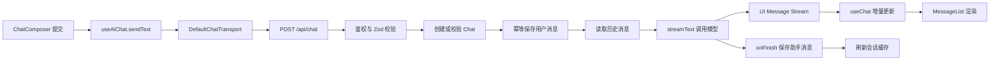

# Wave AI：AI 对话模块学习大纲

## 项目用途与学习目标

Wave AI 的对话模块基于 Next.js、Hono、AI SDK、Prisma、TanStack Query 和 AI Elements 实现。当前代码已经支持登录鉴权、多模型选择、流式回答、消息持久化、停止与重新生成、Markdown 渲染、会话历史以及重命名、置顶和删除。

完成本大纲后，应当能够回答：

1. 用户点击发送后，消息如何经过组件、Hook、API、模型和数据库？
2. AI SDK 的 `UIMessage`、`useChat` 和 `streamText` 分别解决什么问题？
3. 会话所有权、消息幂等和重新生成如何保证数据正确？
4. 流式 Markdown、自动滚动、复制和下载如何实现？
5. 首字延迟和流式卡顿分别如何定位？
6. 如何在现有代码上继续增加工具调用、附件和公开分享？

## 源码基线

- Git 基线：`cc1e49e`。
- 本大纲以当前工作区代码为准；工作区包含尚未提交的聊天侧栏、持久化、消息映射和布局修改。
- 主要技术：Next.js 16、React 19、AI SDK 5、Hono 4、Prisma 6、Zod 4、TanStack Query 5、Streamdown 2。
- 本文件只生成课程大纲，所有课程状态均为 `大纲`，尚未展开为逐段源码讲解。

## 前置知识

- TypeScript 类型收窄、泛型、联合类型和类型守卫。
- React Hook、受控组件、`memo` 和客户端组件。
- Next.js App Router、Server Component、Client Component 和 Route Handler。
- HTTP 请求、中止信号和流式响应。
- Hono 中间件、链式路由与 `HTTPException`。
- Zod 运行时校验与 TypeScript 静态类型的区别。
- Prisma 关系、索引、JSON 字段和唯一键。
- TanStack Query 查询缓存、失效和 Mutation。

## 本次覆盖范围

本次覆盖 `/chat` 页面、`useAiChat`、`POST /api/chat`、模型 Provider、Chat/Message 数据结构、消息映射与幂等持久化、Markdown 消息 UI、会话 CRUD、侧边栏缓存同步和性能定位。

暂不展开 Better Auth 登录注册内部实现、笔记模块、第三方包内部源码、部署、RAG、语音、真实工具执行、完整附件上传、公开分享和断线续传。工具、附件与分享只学习当前预留的扩展边界。

## 代表性调用链



## 课程总览

| 课程 | 主题 | 学完后的产出 |
| --- | --- | --- |
| 01 | 一次对话的端到端流程 | 能画出完整调用链 |
| 02 | 前端状态与传输协议 | 能解释 `useChat` 的状态和请求体 |
| 03 | API、鉴权、校验与模型路由 | 能说明服务端的可信边界 |
| 04 | Prisma、映射、所有权与幂等 | 能解释消息如何可靠落库 |
| 05 | 流生命周期、停止与重新生成 | 能解释流开始、结束和异常路径 |
| 06 | 消息 UI、Markdown 与滚动 | 能追踪一条消息如何显示和操作 |
| 07 | 历史会话 CRUD 与缓存 | 能从侧边栏操作追到数据库 |
| 08 | 性能定位与功能扩展 | 能设计测量和下一阶段方案 |

---

## 课程 01：跑通一次完整的 AI 对话

**读完能回答：** 第一次访问 `/chat` 并发送消息时，页面、Hook、API、模型和数据库如何串联？

**主链：** 访问页面 → 生成或读取 `chatId` → 加载历史 → 提交文本 → 发送 `/api/chat` → 模型生成 → 浏览器读取数据流 → 消息列表渲染 → 助手消息落库。

**必读路径：**

1. `app/(routes)/(dashboard)/chat/page.tsx` 的 `Chat`：输入是 `searchParams.chatId`；下一步选择已有 ID 或生成 UUID；输出是带 `chatId` 的 `ChatShell`。
2. `components/chat/chat-shell.tsx` 的 `ChatShell`：输入是 `chatId/loadHistory`；下一步通过 `useChatDetail` 条件加载历史；输出是加载态、错误态或 `ChatSession`。
3. `components/chat/chat-shell.tsx` 的 `ChatSession`：输入是历史 `UIMessage[]`；下一步连接 `useAiChat`、`MessageList` 和 `ChatComposer`；输出是完整聊天界面。
4. `components/chat/chat-composer.tsx` 的 `ChatComposer`、`handleSubmit`：输入是文本、模型和 `ChatStatus`；下一步调用 `onSubmit`；输出是发送或停止动作。
5. `hooks/use-ai-chat.ts` 的 `useAiChat.sendText`：输入是用户文本；下一步调用 AI SDK `sendMessage`；输出是前端用户消息与网络请求。
6. `app/api/[[...route]]/route.ts` 的 `routes`：输入是 `/api/chat` 请求；下一步交给 `chatRoute`；输出是 Hono Route Handler 响应。
7. `app/api/[[...route]]/chat.ts` 的 `chatRoute.post("/")`：输入是经过鉴权和校验的请求；下一步准备历史并执行 `streamText`；输出是 UI Message Stream。
8. `components/chat/message-list.tsx` 的 `MessageList`：输入是持续变化的 `messages`；下一步渲染消息和状态；输出是用户看到的流式回答。

**选读证据：** 在浏览器 Network 中查看 `/api/chat` 的请求体、等待时间和持续接收过程。

**暂缓阅读：** 幂等算法由课程 04 展开；Markdown 组件由课程 06 展开。

**状态：** `大纲`

---

## 课程 02：理解前端聊天状态与请求协议

**读完能回答：** 为什么输入草稿由页面维护，而消息、错误和生成状态交给 AI SDK？

**主链：** 文本输入 → `sendText` 清理和防重 → `useChat.sendMessage` → transport 重组请求 → 服务端返回流 → `useChat` 更新消息与状态 → 完成后刷新查询缓存。

**必读路径：**

1. `components/chat/chat-shell.tsx` 的 `ChatSession`：输入是页面初始数据；下一步只维护 `input` 和 `selectedModelId`；输出是传给 `useAiChat` 的会话参数。
2. `hooks/use-ai-chat.ts` 的 `chatTransport`：输入是 AI SDK 默认消息集合和 `body`；下一步查找最后一条用户消息；输出是 `id/message/selectedModelId/selectedToolName/trigger` 请求体。
3. `hooks/use-ai-chat.ts` 的 `useChat` 配置：输入是 ID、历史消息和 transport；下一步解析 UI Message Stream；输出是 `messages/status/error`。
4. `hooks/use-ai-chat.ts` 的 `sendText`：输入是原始文本；下一步 trim、清除旧错误并阻止生成期间重复提交；输出是布尔发送结果。
5. `hooks/use-ai-chat.ts` 的 `regenerate`：输入是可选消息 ID；下一步携带当前模型重新请求；输出是新的助手回复分支。
6. `hooks/use-ai-chat.ts` 的 `onFinish`：输入是客户端流完成事件；下一步失效 `chats` 和当前 `chat` 查询；输出是更新后的侧边栏和详情缓存。

**重要分支：**

- 空文本或生成期间提交会返回 `false`，输入框不会清空。
- `submitted` 表示等待首个数据块，`streaming` 表示正在接收内容。
- `experimental_throttle: 50` 合并高频 React 更新，主要影响渲染频率，不决定模型首字时间。
- `initialMessages` 只负责初始化，因此切换 `chatId` 时通过 `key={chatId}` 创建新的聊天实例。

**选读证据：** `components/ai-elements/prompt-input.tsx` 的 `PromptInputTextarea` 和 `PromptInputSubmit`，观察 Enter、中文输入法组合状态与停止按钮。

**暂缓阅读：** React Query 的会话 Mutation 由课程 07 负责。

**状态：** `大纲`

---

## 课程 03：建立 API、鉴权、输入校验与模型路由边界

**读完能回答：** 浏览器提交的数据如何逐层变成可以安全写入数据库并发送给模型的可信输入？

**主链：** HTTP 请求 → Better Auth 鉴权 → Zod 校验外形 → AI SDK 校验消息 parts → 会话所有权校验 → 模型白名单 → Provider Registry → 系统提示词与历史消息。

**必读路径：**

1. `app/api/[[...route]]/route.ts` 的 `app.basePath("/api").route("/chat", chatRoute)`：输入是 Next.js 请求；下一步进入 Hono；输出是带 RPC 类型的路由。
2. `lib/hono/hono-middware.ts` 的 `getAuthUser`：输入是 Cookie 或请求头；下一步调用 Better Auth `getSession`；输出是 Hono Context 中的可信 `user`，未登录返回 401。
3. `lib/chat/schemas.ts` 的 `incomingUserMessageSchema`：输入是客户端消息；下一步限制角色为 `user` 并检查 `id/parts`；输出是结构合法的用户消息。
4. `lib/chat/schemas.ts` 的 `sendChatMessageSchema`：输入是 POST Body；下一步校验 UUID、模型、工具名和触发类型；输出是 Handler 可使用的参数。
5. `app/api/[[...route]]/chat.ts` 的 `validateUIMessages`：输入是通过 Zod 的消息或数据库历史；下一步执行 AI SDK 语义校验；输出是可信 `UIMessage[]`。
6. `lib/ai/model.ts` 的 `CHAT_MODEL_IDS`、`ChatModelId`、`chatModels`：输入是允许使用的模型配置；下一步同时约束 UI 与 Zod 枚举；输出是统一白名单。
7. `lib/ai/provider.ts` 的 `myProvider`：输入是模型 ID；下一步选择 DeepSeek 或 Qwen 实例；输出是 `streamText` 使用的 Language Model。
8. `lib/ai/prompts.ts` 的 `CHAT_SYSTEM_PROMPT`：输入是每轮模型请求；下一步由服务端注入；输出是固定的语言和回答行为约束。

**重要分支：** `selectedToolName` 目前是协议预留字段，非空值会被 POST Handler 返回 400，因为服务端没有注册真实工具。

**选读证据：** 分别提交未登录请求、非法 UUID、`assistant` 角色、未知模型和非空工具名，记录拒绝层级与状态码。

**暂缓阅读：** Better Auth 登录实现和第三方 Provider 内部 HTTP 过程不在本课程范围。

**状态：** `大纲`

---

## 课程 04：掌握 Prisma 数据模型、消息映射、所有权与幂等

**读完能回答：** 消息怎样可靠落库，重复请求为什么不会产生重复记录，其他用户为什么不能借用一个 `chatId`？

**主链：** Chat/Message Schema → 创建或查询会话 → 核对 `userId` → 序列化 UIMessage parts → 以消息 ID 幂等写入 → 核对旧记录 → 读取数据库消息并恢复 UIMessage。

**必读路径：**

1. `prisma/schema.prisma` 的 `Chat`：输入是会话级数据；下一步保存所有者、标题、模型、置顶和更新时间；输出是可查询的会话记录。
2. `prisma/schema.prisma` 的 `Message`、`Role`：输入是 AI SDK 消息；下一步把动态正文放入 `parts/metadata`，把模型和 Token 等可统计数据单独建列；输出是可恢复的消息记录。
3. `prisma/schema.prisma` 的索引与关系：输入是按用户列会话、按会话读消息的查询模式；下一步约束排序和级联删除；输出是数据访问结构。
4. `lib/chat/mapper.ts` 的 `toInputJson`：输入是未知 JSON 数据；下一步序列化；输出是 Prisma `InputJsonValue`。
5. `lib/chat/mapper.ts` 的 `toUIMessage`：输入是数据库 Message；下一步恢复 parts 并合并模型、结束原因、Token 和创建时间；输出是前端可用的 `UIMessage`。
6. `lib/chat/mapper.ts` 的 `getMessageText`、`createProvisionalTitle`：输入是首条用户消息；下一步提取文本、压缩空白并限制 50 字；输出是新会话标题。
7. `lib/chat/persistence.ts` 的 `getOrCreateOwnedChat`：输入是 `id/userId/modelId/firstMessage`；下一步使用 `createMany + skipDuplicates` 并查询归属；输出是合法 Chat 或 `ChatOwnershipError`。
8. `lib/chat/persistence.ts` 的 `saveMessageOnce`：输入是 `chatId + UIMessage`；下一步按消息主键跳过重复插入并核对 chat、role、parts；输出是唯一 Message 或 `MessageConflictError`。
9. `app/api/[[...route]]/chat.ts` 的 `throwApiError`：输入是业务异常或未知错误；下一步映射错误；输出是 404、409 或通用 500。

**重要分支：** 相同消息 ID、相同会话和相同内容属于合法重试；相同 ID 指向其他会话或其他内容属于冲突。

**选读证据：** 对照 `prisma/migrations/20260923122414_add_chat_pinning/migration.sql` 和 `prisma/migrations/20260923172552_align_chat_message_schema/migration.sql`，理解数据库演进。

**暂缓阅读：** 生产迁移流程、分布式事务和补偿队列尚未实现。

**状态：** `大纲`

---

## 课程 05：理解流生命周期、停止、重新生成和完成落库

**读完能回答：** 为什么页面能先显示逐步生成的内容，而助手消息、结束原因和 Token 用量要在生成结束后保存？

**主链：** 升序读取历史 → 重新生成时截断旧消息 → 转换模型消息 → `streamText` → UI Message Stream → 浏览器增量合并 → `onFinish` 保存助手消息 → 更新会话模型与缓存。

**必读路径：**

1. `app/api/[[...route]]/chat.ts` 的 `prisma.message.findMany`：输入是会话 ID；下一步按 `createdAt asc` 读取完整历史；输出是数据库消息数组。
2. `app/api/[[...route]]/chat.ts` 的 `savedUserMessage.created` 分支：输入是用户消息是否首次写入；下一步区分普通重复提交与 `regenerate-message`；输出是 409 或重新生成流程。
3. `app/api/[[...route]]/chat.ts` 的 `laterMessageIds/deleteMany`：输入是重新生成目标的位置；下一步删除目标之后的旧消息；输出是截断后的对话历史。
4. `app/api/[[...route]]/chat.ts` 的 `convertToModelMessages`、`streamText`：输入是经过验证的完整历史；下一步调用所选 Provider；输出是生成结果流。
5. `app/api/[[...route]]/chat.ts` 的 `toUIMessageStreamResponse`：输入是模型流和原始消息；下一步生成助手消息 ID并传输文本、推理、来源和 metadata；输出是浏览器可解析的数据流。
6. `hooks/use-ai-chat.ts` 的 `useChat`：输入是 UI Message Stream；下一步把增量 part 合并到当前助手消息；输出是持续更新的 `messages`。
7. `app/api/[[...route]]/chat.ts` 的 `onFinish`：输入是 `responseMessage/isAborted`；下一步读取 `finishReason/totalUsage` 并保存助手消息；输出是刷新后可恢复的数据。
8. `hooks/use-ai-chat.ts` 与 `components/chat/chat-composer.tsx` 的 `stop/onStop`：输入是用户停止；下一步中止请求；输出是停止继续接收，并在 metadata 中记录中止状态。

**重要分支：**

- `maxRetries: 2` 能自动重试模型错误，也可能延长首字等待。
- 外层 `try/catch` 处理流建立前错误；两个 `onError` 分别负责模型流日志和用户可见错误。
- 完成后数据库保存失败时，用户可能已看到回答，但刷新后不能恢复；当前只有日志，没有后台补偿。

**选读证据：** 分别验证正常完成、手动停止、断网和错误 API Key，比较前端状态、服务端日志和数据库记录。

**暂缓阅读：** 跨刷新续传和持久化补偿任务尚未实现。

**状态：** `大纲`

---

## 课程 06：学习消息 UI、Markdown、滚动与消息操作

**读完能回答：** 流式文本如何变成 Markdown、代码块和可操作消息，同时让滚动区域保持稳定？

**主链：** messages 更新 → `MessageList` 遍历 → `ChatMessage` 提取 text parts → 用户文本或助手 Markdown → Conversation 管理贴底滚动 → 操作栏复制、下载或重新生成。

**必读路径：**

1. `components/chat/message-list.tsx` 的 `MessageList`：输入是消息、状态和错误；下一步渲染消息、等待首块和错误重试；输出是独立滚动内容区。
2. `components/chat/message-list.tsx` 的 `ChatMessage`：输入是单条 `UIMessage`；下一步过滤 text parts 并按角色选择展示；输出是消息正文和操作按钮。
3. `components/ai-elements/message.tsx` 的 `MessageResponse`：输入是助手文本；下一步使用 Streamdown 的 cjk/code/math/mermaid 插件；输出是 Markdown、代码、公式和 Mermaid。
4. `components/ai-elements/conversation.tsx` 的 `Conversation`、`ConversationContent`：输入是不断增长的节点；下一步交给 `use-stick-to-bottom`；输出是自动贴底的滚动容器。
5. `components/ai-elements/conversation.tsx` 的 `ConversationScrollButton`：输入是 `isAtBottom`；下一步在用户向上阅读时显示；输出是回到底部操作。
6. `components/chat/message-list.tsx` 的 `copyText`、`downloadMarkdown`：输入是合并后的文本；下一步写入剪贴板或创建 Blob URL；输出是复制结果或单条 Markdown 文件。
7. `components/ai-elements/conversation.tsx` 的 `messagesToMarkdown`、`ConversationDownload`：输入是完整消息列表；下一步格式化并创建文件；输出是整段会话 Markdown，当前业务页面尚未挂载此按钮。

**重要分支：** 服务端允许传输 reasoning 和 sources，但业务 `MessageList` 当前只主动渲染 text parts；其他 part 仍需要专用 UI。

**选读证据：** 让模型生成长代码、表格、公式和 Mermaid，使用 React Profiler 观察流式渲染和滚动。

**暂缓阅读：** 虚拟列表与附件卡片尚未接入。

**状态：** `大纲`

---

## 课程 07：掌握历史会话 CRUD 与 React Query 缓存同步

**读完能回答：** 打开、重命名、置顶和删除会话时，URL、API、数据库和侧边栏如何保持一致？

**主链：** 查询会话列表 → 点击项目写入 `chatId` → 查询详情并初始化消息 → 菜单触发 PATCH/DELETE → API 按 `id + userId` 修改 → Mutation 失效或移除缓存 → 侧边栏重新排序。

**必读路径：**

1. `app/api/[[...route]]/chat.ts` 的 `GET /`：输入是 `cursor/limit`；下一步按用户以及置顶、置顶时间、更新时间、ID 排序；输出是 `items/nextCursor`。
2. `app/api/[[...route]]/chat.ts` 的 `GET /:id`：输入是会话 ID和当前用户；下一步查询 Chat 与升序 Message；输出是会话详情与 `UIMessage[]`。
3. `app/api/[[...route]]/chat.ts` 的 `PATCH /:id`：输入是 `title/isPinned`；下一步以 `id + userId` 为更新条件；输出是更新后的 Chat。
4. `app/api/[[...route]]/chat.ts` 的 `DELETE /:id`：输入是会话 ID和当前用户；下一步删除 Chat；输出是成功状态，关联 Message 级联删除。
5. `hooks/use-chat-list.ts` 的 `useChatList`、`useChatDetail`：输入是列表数量或会话 ID；下一步调用 Hono RPC；输出是 React Query 列表和详情缓存。
6. `hooks/use-chat-list.ts` 的 `useUpdateChat`、`useDeleteChat`：输入是菜单动作；下一步调用 PATCH/DELETE 并失效或移除查询；输出是重新同步后的缓存。
7. `components/sidebar/nav-chats.tsx` 的 `NavChats`：输入是列表缓存和 URL 的 `chatId`；下一步处理加载、错误、空态和激活态；输出是侧边栏会话列表。
8. `components/sidebar/chat-sidebar-item.tsx` 的 `ChatSidebarItem`：输入是单条会话；下一步处理导航、重命名 Dialog、置顶和删除确认；输出是 Mutation 与必要的页面跳转。

**重要分支：** API 已返回 `nextCursor`，但前端现在使用普通 `useQuery` 并一次请求最多 50 条，没有实现无限滚动。

**选读证据：** 连续置顶多个会话、重命名、删除当前会话并刷新，观察 URL、列表顺序、缓存和数据库。

**暂缓阅读：** 会话搜索、归档、批量操作和乐观更新尚未实现。

**状态：** `大纲`

---

## 课程 08：定位性能问题并理解后续扩展入口

**读完能回答：** 首字慢和输出卡顿分别检查哪里；工具、附件与分享应该从哪些现有边界接入？

**主链：** 分段测量请求 → 区分服务端准备、模型首 Token 和前端渲染 → 优化数据库与上下文 → 检查已有 UI parts 能力 → 扩展输入和 Schema → 注册服务端能力 → 增加专用消息 UI 与权限控制。

**必读路径：**

1. `hooks/use-ai-chat.ts` 的 `status`：输入是请求生命周期；下一步区分 `submitted` 和 `streaming`；输出是“等待首块”与“正在生成”两段测量窗口。
2. `lib/hono/hono-middware.ts` 的 `getAuthUser`：输入是每次聊天请求；下一步读取 Session；输出是模型调用前的鉴权耗时。
3. `app/api/[[...route]]/chat.ts` 的 POST 前半段：输入是合法请求；下一步串行处理会话、消息、历史和校验；输出是调用模型之前的准备耗时。
4. `lib/chat/persistence.ts` 的两个保存函数：输入是会话和消息；下一步执行写入、查询和必要更新；输出是多次数据库往返，也是首字延迟候选点。
5. `app/api/[[...route]]/chat.ts` 的完整历史和 `maxRetries: 2`：输入是不断增长的上下文；下一步增加模型提示词处理或失败重试；输出是模型首 Token 等待。
6. `hooks/use-ai-chat.ts` 的 `experimental_throttle` 与 `components/ai-elements/message.tsx` 的 `MessageResponse`：输入是高频增量文本；下一步合并 React 更新并解析 Markdown；输出是流式阶段的页面流畅度。
7. `components/ai-elements/prompt-input.tsx` 的附件 Context 与 `FileUIPart`：输入是选择、拖放或粘贴文件；下一步转换文件 part；输出是已有的附件输入基础，但 `ChatComposer` 当前只提交 text。
8. `lib/chat/schemas.ts` 与 `app/api/[[...route]]/chat.ts` 的 `selectedToolName`：输入是工具选择；下一步当前明确拒绝非空值；输出是等待接入工具注册、参数校验、超时和结果持久化的协议边界。
9. `prisma/schema.prisma` 的 `Message.parts`：输入是 text/reasoning/source/file/tool 等 part；下一步以 JSON 保存；输出是扩展消息类型的基础数据容器。
10. `docs/ai-chat-sharing-plan.md`：输入是公开分享需求；下一步规划公开标识、只读接口、撤销分享和隐私过滤；输出是设计文档，当前 Schema、API 和页面尚未实现分享。

**建议测量：**

| 指标 | 起点 | 终点 | 当前数据 |
| --- | --- | --- | --- |
| API 准备耗时 | POST Handler 开始 | `streamText` 调用前 | 待测 |
| 模型首 Token | `streamText` 开始 | 第一个响应 chunk | 待测 |
| 完整生成耗时 | `streamText` 开始 | 服务端 `onFinish` | 待测 |
| 完成落库耗时 | `onFinish` 开始 | Chat/Message 更新完成 | 待测 |
| 前端渲染流畅度 | `streaming` 开始 | 状态回到 `ready` | 待测 |

**优化实验顺序：** 先加分段计时；再减少模型调用前的串行数据库查询；随后限制历史条数或 Token；对比不同模型的首字时间；最后再调整 throttle、Markdown 流式策略或引入虚拟列表。没有测量前不填写性能提升比例。

**扩展时必须定义：**

- 工具调用：允许列表、参数 Schema、服务端执行、超时、失败状态和用户确认。
- 附件：大小与类型、对象存储、临时 URL、访问权限和失败清理。
- 分享：不可枚举的公开标识、只读数据投影、撤销规则和敏感信息过滤。
- 消息 UI：分别处理 `reasoning`、`source-*`、`file` 和 `tool-*`，不要把未知 part 当作普通文本。

**选读证据：** 浏览器 Performance、Network Timing、React Profiler、服务端分段日志，以及 AI Elements 中尚未挂载的附件与会话下载组件。

**暂缓阅读：** 数据库区域迁移、对象存储供应商、具体工具清单和分享页面视觉稿需要后续需求与部署数据。

**状态：** `大纲`

---

## 学完后的自测题

1. 不看代码画出发送消息的时序图，并标出用户消息和助手消息分别何时落库。
2. 为什么客户端只提交最后一条用户消息，模型仍然能获得完整历史？
3. Zod 校验和 `validateUIMessages` 各自解决什么问题？
4. `createMany + skipDuplicates + findUnique` 如何实现幂等，又为什么可能增加延迟？
5. 重新生成为什么需要删除目标消息之后的记录？
6. `submitted`、`streaming`、`ready` 和 `error` 各自对应什么页面行为？
7. 停止生成后，已收到内容、`isAborted` 和数据库记录之间是什么关系？
8. 重命名、置顶和删除之后，React Query 如何同步侧边栏与详情？
9. 首字慢和流式渲染卡顿各有哪些可测量原因？
10. 设计一个最小附件或工具流程，明确前端、Schema、API、消息 UI 和权限层的改动。

## 推荐验证命令

```bash
npm run typecheck
npm run lint
npm run build
npm run dev
```

运行项目后，至少手动验证：新会话发送、流式输出、停止生成、重新生成、刷新恢复、切换模型、复制、Markdown 下载、历史加载、重命名、置顶、删除和双用户会话隔离。

## 自学提醒

若某文件或原理看不懂，请继续追问 AI，并指定课程编号要求展开或生成配套理解题；本大纲负责给出学习路径与题目，不提供逐行讲解。
