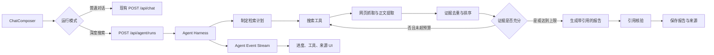
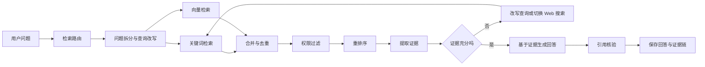

# Wave AI：联网深度搜索 Agent 与 Agent Harness 实现方案

## 1. 文档目标

本文档基于 Wave AI 当前的 AI 对话模块，规划以下两类能力：

1. 联网深度搜索 Agent：围绕用户问题制定检索计划，多轮搜索和阅读网页，整理证据并生成带来源引用的报告。
2. Agent Harness：为 Agent 提供运行状态、工具管理、预算限制、中止恢复、持久化、可观测性和人工审批等基础设施。

当前普通聊天接口继续负责短生命周期的文本对话。深度搜索使用独立的 Agent 执行链，避免把长时间、多步骤任务继续堆积在 `POST /api/chat` 中。

## 2. 当前项目基础

项目已经具备：

- `app/api/[[...route]]/chat.ts`：Hono 流式聊天接口。
- `hooks/use-ai-chat.ts`：基于 AI SDK `useChat` 的前端交互 Hook。
- `lib/ai/provider.ts`：DeepSeek 和 Qwen 模型注册。
- `lib/chat/schemas.ts`：聊天请求的 Zod 校验。
- `lib/chat/persistence.ts`：会话所有权和消息幂等持久化。
- `prisma/schema.prisma`：Chat、Message 以及 JSON `parts` 消息结构。
- `components/chat/message-list.tsx`：文本、Markdown、复制、下载和重新生成。
- `components/ai-elements/prompt-input.tsx`：附件和引用来源相关的底层组件能力。
- `components/ai-elements/message.tsx`：Streamdown Markdown、代码、数学公式和 Mermaid 渲染。

当前依赖为 AI SDK 5：

```text
ai@5.0.23
@ai-sdk/react@2.0.23
@ai-sdk/deepseek@1.0.58
@ai-sdk/alibaba@0.0.30
```

AI SDK 5 已提供 `Experimental_Agent`、`streamText`、`tools`、`stopWhen`、`prepareStep` 和 `onStepFinish`。当前官方版本使用稳定的 `ToolLoopAgent`，因此建议在正式开发 Agent Harness 前，用独立提交升级 AI SDK 6，并先回归现有聊天功能。

参考资料：

- [AI SDK 5 升级到 6](https://ai-sdk.dev/docs/migration-guides/migration-guide-6-0)
- [AI SDK Agent 概览](https://ai-sdk.dev/docs/agents/overview)
- [AI SDK ToolLoopAgent](https://ai-sdk.dev/docs/reference/ai-sdk-core/tool-loop-agent)

如果暂时不升级，可以先使用当前版本的 `streamText` 完成最小工具循环：

```ts
streamText({
  model,
  tools,
  stopWhen: stepCountIs(8),
  prepareStep,
  onStepFinish,
})
```

不建议围绕 `Experimental_Agent` 编写过多业务封装，因为升级 AI SDK 6 后仍需迁移为 `ToolLoopAgent`。

## 3. 总体架构



普通聊天和深度搜索的职责边界：

| 能力 | 普通聊天 | 深度搜索 Agent |
| --- | --- | --- |
| 执行时间 | 较短 | 可能较长 |
| 模型调用 | 通常一次 | 多步骤、多轮调用 |
| 工具 | 默认不使用 | 搜索、抓取、证据整理 |
| 持久化 | Chat + Message | Chat + Message + AgentRun |
| 刷新恢复 | 恢复历史消息 | 恢复运行阶段、步骤和报告 |
| 前端展示 | 消息流 | 消息流 + 进度 + 工具 + 来源 |

## 4. 深度搜索 Workflow

深度搜索不应完全依赖模型自由循环。推荐采用“固定工作流 + 局部 Agent 决策”。

### 4.1 问题规划

输入用户原始问题，生成结构化检索计划：

- 核心问题。
- 需要验证的子问题。
- 时间范围。
- 需要对比的对象。
- 第一轮搜索查询，建议 3～6 条。

规划结果使用结构化 Schema 校验，不直接保存模型自由文本。

### 4.2 第一轮搜索

并发执行搜索查询，得到统一结果：

```ts
interface SearchResult {
  title: string
  url: string
  snippet: string
  publishedAt?: string
  sourceName?: string
}
```

搜索结果需要：

- URL 规范化。
- 相同来源去重。
- 标题和摘要去重。
- 保存发布时间和抓取时间。
- 按相关性、时效性和来源质量排序。

### 4.3 网页抓取与正文提取

从排名靠前的结果中选择有限数量页面，受控并发抓取：

- 只允许 `http` 和 `https`。
- 阻止内网、回环地址和保留 IP，避免 SSRF。
- 限制重定向次数、响应大小和超时时间。
- 校验 Content-Type。
- HTML 转换成正文，去除导航、脚本和广告。
- PDF 等复杂内容放到后续阶段。

网页内容必须作为不可信数据处理。页面中的提示词或操作指令不能覆盖系统提示词，也不能直接触发其他工具。

### 4.4 证据整理

从网页正文中提取和问题相关的证据：

```ts
interface Evidence {
  sourceId: string
  claim: string
  excerpt: string
  url: string
  title: string
  publishedAt?: string
}
```

每条证据必须指向已保存的来源。最终回答不能引用模型自己生成、但数据库中不存在的来源 ID。

### 4.5 缺口分析与补充搜索

根据已经收集的证据判断：

- 是否回答了全部子问题。
- 是否缺少最新信息。
- 是否只有单一来源。
- 是否存在相互冲突的结论。
- 是否需要反面证据。

最多执行 1～2 轮补充搜索。达到步骤、工具、时间或 Token 上限后必须进入报告阶段，不能无限循环。

### 4.6 报告生成与引用核验

报告生成阶段只接收经过筛选的证据，不直接接收全部网页正文。

输出包含：

- 简要结论。
- 分主题分析。
- 信息不确定性。
- 行内引用。
- 来源列表。

报告完成后执行一次引用核验：

- 关键事实是否有来源。
- 引用是否支持对应结论。
- 来源是否失效。
- 是否把旧信息表述成当前事实。
- 是否遗漏互相冲突的来源。

## 5. Agent Harness 组成

### 5.1 Agent Registry

Agent 注册表根据 `agentKey` 创建对应 Agent：

```ts
type AgentKey = "deep-research"

interface AgentDefinition {
  key: AgentKey
  createRunner(context: AgentContext): AgentRunner
}
```

后续可以继续注册代码分析、文档总结或数据分析 Agent，不需要让 API Handler 了解每个 Agent 的内部流程。

### 5.2 Tool Registry

所有工具集中定义：

- 工具名称和描述。
- Zod 输入 Schema。
- 输出结构。
- 权限级别。
- 是否需要人工批准。
- 超时和重试策略。
- 单次输出大小限制。
- 可用 Agent 列表。

### 5.3 Run State Machine

建议状态：

```text
queued
  → planning
  → searching
  → reading
  → synthesizing
  → verifying
  → completed
```

任意运行阶段还可以进入：

```text
waitingApproval
failed
cancelled
```

状态更新需要比较当前状态，避免并发回调把已经取消的运行重新标记成执行中。

### 5.4 Budget Controller

至少限制：

- 最大模型步骤数。
- 最大工具调用数。
- 最大搜索轮数。
- 最大抓取页面数。
- 单个工具超时。
- 整个运行超时。
- 最大输入和输出 Token。
- 工具结果最大字符数。
- 同时抓取页面数量。

预算由 Harness 强制执行，不能只写在 Prompt 中让模型自行遵守。

### 5.5 Context Manager

Context Manager 决定每一步模型能看到什么：

- 当前用户问题。
- 结构化研究计划。
- 已调用工具摘要。
- 经过筛选的证据。
- 剩余预算。
- 当前阶段允许使用的工具。

不要在每一步重复发送所有网页全文。长正文应保存在数据库或对象存储中，只把相关证据和摘要放进模型上下文。

### 5.6 Event Stream

Harness 应产生结构化事件：

```ts
type AgentEvent =
  | { type: "run-started"; runId: string }
  | { type: "phase-changed"; phase: string }
  | { type: "plan-created"; queries: string[] }
  | { type: "tool-started"; toolCallId: string; toolName: string }
  | { type: "tool-completed"; toolCallId: string; summary: string }
  | { type: "source-added"; sourceId: string; title: string; url: string }
  | { type: "report-delta"; text: string }
  | { type: "run-completed" }
  | { type: "run-failed"; message: string }
```

前端根据事件渲染进度，不依赖解析模型自然语言判断运行阶段。

### 5.7 Cancellation、Idempotency 与 Recovery

- 每个运行持有一个 `AbortController`。
- API 取消操作同时更新数据库状态并发送 abort。
- `toolCallId` 在同一运行内保持唯一。
- 相同工具调用重试时复用已有成功结果。
- 每一步完成后保存状态，刷新页面可以读取最后一个完成步骤。
- 长任务如果必须脱离浏览器继续运行，应交给 Worker 或任务队列，不能依赖一个持续打开的 HTTP 请求。

### 5.8 Approval

联网搜索和读取网页属于只读工具，第一版可以自动执行。

以下工具需要人工批准：

- 删除或修改用户数据。
- 发送邮件或消息。
- 创建外部资源。
- 支付或购买。
- 执行代码、Shell 或数据库写操作。

AI SDK 新版支持服务端工具的 `needsApproval` 以及前端 `addToolApprovalResponse`：

- [AI SDK 工具审批](https://ai-sdk.dev/docs/ai-sdk-ui/chatbot-tool-usage)
- [AI SDK 工具调用](https://ai-sdk.dev/docs/ai-sdk-core/tools-and-tool-calling)

## 6. 推荐目录结构

```text
lib/agent/
  types.ts                     # Run、Step、Event 等类型
  registry.ts                  # Agent 注册表
  runner.ts                    # Harness 主执行器
  budgets.ts                   # 步骤、工具、时间和 Token 预算
  context.ts                   # 上下文选择和压缩
  events.ts                    # 事件写入和流式分发
  errors.ts                    # Agent 错误类型与安全映射
  policy.ts                    # 工具权限和审批策略

  agents/
    deep-research.ts           # 深度搜索 Workflow
    prompts.ts                 # 规划、缺口分析、写作和核验 Prompt

  tools/
    web-search.ts              # 搜索工具
    web-fetch.ts               # 网页抓取工具
    extract-content.ts         # 正文和证据提取
    finalize-report.ts         # 完成报告工具

  providers/
    search-provider.ts         # 搜索服务抽象

app/api/[[...route]]/
  agent.ts                     # Agent Run API

hooks/
  use-agent-run.ts             # 创建、订阅、取消和恢复运行

components/agent/
  agent-progress.tsx           # 阶段和总体进度
  agent-plan.tsx               # 检索计划
  agent-tool-call.tsx          # 工具调用状态
  research-source-list.tsx     # 来源列表
  research-report.tsx          # 最终报告和引用
  agent-approval.tsx           # 人工审批
```

## 7. Search Provider 抽象

不要让 Agent 直接依赖某个搜索供应商。定义统一接口：

```ts
export interface SearchProvider {
  search(input: {
    query: string
    limit: number
    freshness?: "day" | "week" | "month" | "any"
    domains?: string[]
  }): Promise<SearchResult[]>
}
```

工具层只调用这个接口。更换搜索服务时，只替换 Provider 实现。

第一版建议使用 `qwen-plus` 验证工具循环。Alibaba AI SDK Provider 官方文档明确提供了 Qwen 工具调用示例：

- [Alibaba AI SDK Provider](https://ai-sdk.dev/providers/ai-sdk-providers/alibaba)

DeepSeek 也支持工具调用，但真正的工具函数仍需要应用服务端实现和执行：

- [DeepSeek Tool Calls](https://api-docs.deepseek.com/guides/tool_calls/)

所有项目模型都应分别做工具调用能力测试，不能只通过模型名称推断支持程度。

## 8. Prisma 数据结构

最终可见回答继续保存到现有 `Message.parts`。Agent 的完整运行过程使用独立数据表，避免把运行日志全部塞进 Message。

```prisma
enum AgentRunStatus {
  queued
  running
  waitingApproval
  completed
  failed
  cancelled
}

model AgentRun {
  id            String         @id @default(uuid())
  agentKey      String
  status        AgentRunStatus @default(queued)
  phase         String?
  input         Json
  output        Json?
  error         Json?
  stepCount     Int            @default(0)
  toolCallCount Int            @default(0)
  maxSteps      Int
  maxToolCalls  Int
  startedAt     DateTime?
  completedAt   DateTime?
  createdAt     DateTime       @default(now())
  updatedAt     DateTime       @updatedAt

  userId String
  chatId String
  user   User   @relation(fields: [userId], references: [id], onDelete: Cascade)
  chat   Chat   @relation(fields: [chatId], references: [id], onDelete: Cascade)

  steps   AgentStep[]
  sources ResearchSource[]

  @@index([userId, status, createdAt])
  @@index([chatId, createdAt])
}

model AgentStep {
  id         String   @id @default(uuid())
  runId      String
  sequence   Int
  type       String
  status     String
  toolName   String?
  toolCallId String?
  input      Json?
  output     Json?
  error      Json?
  durationMs Int?
  usage      Json?
  createdAt  DateTime @default(now())
  updatedAt  DateTime @updatedAt

  run AgentRun @relation(fields: [runId], references: [id], onDelete: Cascade)

  @@unique([runId, sequence])
  @@unique([runId, toolCallId])
  @@index([runId, status])
}

model ResearchSource {
  id           String   @id @default(uuid())
  runId        String
  url          String
  canonicalUrl String?
  title        String
  snippet      String?
  contentHash  String?
  score        Float?
  publishedAt  DateTime?
  fetchedAt    DateTime?
  createdAt    DateTime @default(now())

  run AgentRun @relation(fields: [runId], references: [id], onDelete: Cascade)

  @@index([runId])
}
```

还需要在现有模型中增加关系：

```prisma
model User {
  // 原有字段……
  agentRuns AgentRun[]
}

model Chat {
  // 原有字段……
  agentRuns AgentRun[]
}
```

最终消息可以继续使用 AI SDK part：

```ts
parts: [
  { type: "text", text: report },
  { type: "source-url", sourceId: "S1", url, title },
  { type: "source-url", sourceId: "S2", url, title },
]
```

## 9. API 设计

保留现有 `/api/chat`，新增：

| 方法 | 路径 | 作用 |
| --- | --- | --- |
| `POST` | `/api/agent/runs` | 创建深度搜索任务 |
| `GET` | `/api/agent/runs/:id` | 获取任务快照 |
| `GET` | `/api/agent/runs/:id/events` | 读取运行事件流 |
| `POST` | `/api/agent/runs/:id/cancel` | 取消运行 |
| `POST` | `/api/agent/runs/:id/approve` | 同意或拒绝工具执行 |
| `POST` | `/api/agent/runs/:id/retry` | 从失败位置重新执行 |

### 9.1 创建运行

```ts
{
  chatId: string
  message: UIMessage
  agentKey: "deep-research"
  selectedModelId: ChatModelId
  options: {
    depth: "quick" | "standard" | "deep"
    freshness?: "day" | "week" | "month" | "any"
  }
}
```

服务端必须从 Session 获取 `userId`，不接受客户端传入的用户身份。

### 9.2 运行快照

```ts
{
  run: {
    id: string
    status: AgentRunStatus
    phase: string | null
    stepCount: number
    toolCallCount: number
  }
  steps: AgentStep[]
  sources: ResearchSource[]
  resultMessage?: UIMessage
}
```

### 9.3 事件恢复

事件需要具有递增序号。前端重新连接时携带最后收到的序号：

```text
GET /api/agent/runs/:id/events?after=42
```

服务端先补发序号 42 之后的持久化事件，再继续推送实时事件。

## 10. 工具设计

第一版只实现只读工具：

```ts
searchWeb({
  query,
  limit,
  freshness,
  domains,
})

fetchPage({
  url,
})

saveEvidence({
  sourceId,
  claim,
  excerpt,
})
```

工具必须具备：

- 严格的 Zod 输入 Schema。
- 统一错误结构。
- 超时和中止信号。
- 幂等键。
- 输出大小限制。
- 日志和耗时统计。
- 权限级别。
- 安全的用户可见错误。

AI SDK 可以在工具返回结果后自动继续下一步，并通过 `stopWhen` 限制多轮调用：

- [AI SDK 多步工具调用](https://ai-sdk.dev/docs/ai-sdk-core/tools-and-tool-calling)

## 11. 前端设计

### 11.1 输入区

在 `components/chat/chat-composer.tsx` 增加模式选择：

```text
普通对话
深度搜索
```

深度搜索可以增加搜索深度：

```text
快速：一轮搜索，少量来源
标准：两轮搜索，来源交叉验证
深入：更多来源和一次引用核验
```

模式对应的真实预算由服务端决定，前端值只用于表达用户意图。

### 11.2 运行过程

显示：

- 当前阶段。
- 已完成步骤数。
- 搜索计划。
- 正在执行的查询。
- 工具成功或失败状态。
- 已找到来源数量。
- 取消按钮。
- 失败后的重试按钮。

不展示模型原始思维链。只展示简要计划、运行状态、工具输入输出和证据来源。

### 11.3 最终报告

显示：

- Markdown 报告。
- 行内来源引用。
- 来源抽屉或侧栏。
- 来源标题、域名、时间和链接。
- 信息不确定性。
- 导出 Markdown。
- 后续接入公开分享。

### 11.4 UIMessage Parts

扩展 `components/chat/message-list.tsx`，按 part 类型渲染：

```text
text
reasoning
source-url
source-document
tool-searchWeb
tool-fetchPage
data-agent-status
data-research-plan
```

未知 part 显示安全占位，不能导致整条消息渲染失败。

## 12. 可观测性

每次 AgentRun 记录：

- `runId`、`userId`、`chatId` 和 `agentKey`。
- 首次开始时间和完成时间。
- 当前阶段和最终状态。
- 模型步骤数和工具调用数。
- 每个模型调用的首 Token、总耗时和 Token 用量。
- 每个工具的耗时、结果大小和失败分类。
- 来源数量、去重数量和引用数量。
- 是否由用户取消。
- 是否发生模型或工具重试。

AI SDK 提供基于 OpenTelemetry 的实验性 Telemetry：

- [AI SDK Telemetry](https://ai-sdk.dev/docs/ai-sdk-core/telemetry)

Telemetry 可以作为补充，数据库中的 Run/Step 状态仍然是产品恢复和用户界面所需的业务数据。

## 13. Agentic RAG 与引用溯源

### 13.1 能力定位

联网深度搜索主要解决公开互联网中的新信息；RAG 主要解决用户或项目自有知识库中的可信资料。Agentic RAG 在普通 RAG 之上增加路由、查询改写、多轮检索、工具选择和证据充分性判断。

一次请求先由检索路由器选择：

```text
普通问答       → 不检索，直接对话
内部知识问题   → Knowledge RAG
时效性问题     → Web Research
混合问题       → Knowledge RAG + Web Research
```

路由选择需要保存到 AgentStep，便于评测错误路由。不能只把路由判断留在 Prompt 中而不记录结果。

### 13.2 Agentic RAG 主链



建议步骤：

1. 判断是否需要检索，以及使用内部知识库、互联网或混合检索。
2. 把复杂问题拆成多个可检索子问题。
3. 同时执行关键词检索和向量检索。
4. 按用户、租户、文档可见性和时间范围过滤结果。
5. 合并结果并使用 Reranker 重新排序。
6. 从 Top K Chunk 中提取结构化证据。
7. 判断证据是否覆盖全部子问题。
8. 证据不足时改写查询或使用 Web Search 补充。
9. 只把高相关证据和邻接 Chunk 交给回答模型。
10. 生成回答后逐条核验引用。

### 13.3 知识入库 Pipeline

知识库写入和 Agent 查询分开处理：

```text
文件或网页
  → 内容解析
  → 标题与章节识别
  → 分块
  → 记录文档版本和定位信息
  → 生成 Embedding
  → 写入关键词索引和向量索引
  → 标记可检索版本
```

每个 Chunk 至少保存：

- 文档 ID和文档版本 ID。
- Chunk 顺序。
- 标题层级或章节路径。
- 页码、段落、时间轴等定位信息。
- 原始文本。
- 内容哈希。
- Token 数量。
- Embedding。
- 用户、租户和可见性字段。

分块不能只按固定字符数切割。应优先保留 Markdown 标题、段落、代码块、表格和 PDF 页码等语义边界，并允许检索命中后补充相邻 Chunk。

### 13.4 Agentic RAG 工具

建议增加：

```ts
searchKnowledge({
  query,
  filters,
  limit,
})

fetchChunkNeighbors({
  chunkId,
  before,
  after,
})

rerankEvidence({
  query,
  evidenceIds,
})

searchWeb({
  query,
  freshness,
})
```

`searchKnowledge` 内部执行混合检索与权限过滤；模型不直接接触底层向量数据库。`rerankEvidence` 可以先作为服务端确定性步骤，只有确实需要动态选择时才暴露成 Agent Tool。

### 13.5 引用溯源链

一条引用需要形成下面的证据链：

```text
回答中的 Claim
  → Citation
  → Evidence
  → DocumentChunk 或 ResearchSource
  → DocumentVersion 或网页快照
  → 原始 URL / 文件 / 页码 / 章节
```

前端展示 `[1]`、`[2]` 只是显示层。数据库中必须保存稳定 ID，不能只保存 Markdown 链接。

建议新增统一证据和引用结构：

```prisma
enum EvidenceKind {
  knowledge
  web
}

model KnowledgeDocument {
  id          String   @id @default(uuid())
  title       String
  sourceType  String
  sourceUrl   String?
  visibility String
  userId      String?
  createdAt   DateTime @default(now())
  updatedAt   DateTime @updatedAt

  chunks KnowledgeChunk[]

  @@index([userId, visibility])
}

model KnowledgeChunk {
  id           String   @id @default(uuid())
  documentId   String
  version      Int
  sequence     Int
  headingPath  String?
  locator      Json?
  content      String
  contentHash  String
  tokenCount   Int?
  embedding    Unsupported("vector")?
  createdAt    DateTime @default(now())

  document KnowledgeDocument @relation(fields: [documentId], references: [id], onDelete: Cascade)
  evidence Evidence[]

  @@unique([documentId, version, sequence])
  @@index([documentId, version])
}

model Evidence {
  id             String       @id @default(uuid())
  runId          String
  kind           EvidenceKind
  chunkId        String?
  researchSourceId String?
  title          String
  url            String?
  locator        Json?
  excerpt        String
  contentHash    String
  relevanceScore Float?
  rerankScore    Float?
  createdAt      DateTime     @default(now())

  run              AgentRun        @relation(fields: [runId], references: [id], onDelete: Cascade)
  chunk            KnowledgeChunk? @relation(fields: [chunkId], references: [id], onDelete: SetNull)
  researchSource   ResearchSource? @relation(fields: [researchSourceId], references: [id], onDelete: SetNull)
  citations        Citation[]

  @@index([runId, kind])
}

model Citation {
  id          String   @id @default(uuid())
  messageId   String
  evidenceId  String
  label       String
  partIndex   Int
  startOffset Int?
  endOffset   Int?
  claim       String?
  createdAt   DateTime @default(now())

  message  Message  @relation(fields: [messageId], references: [id], onDelete: Cascade)
  evidence Evidence @relation(fields: [evidenceId], references: [id], onDelete: Cascade)

  @@unique([messageId, label])
  @@index([evidenceId])
}
```

`Unsupported("vector")` 只是 PostgreSQL 向量列的设计示例。正式迁移前需要根据最终使用的 pgvector 或外部向量数据库确认 Prisma 查询方式。

还需要为 `Message`、`AgentRun` 和 `ResearchSource` 增加对应关系字段。

### 13.6 引用生成规则

- 模型只能引用本轮提供的 Evidence ID。
- 引用必须绑定具体 Claim，不能只在回答结尾堆积来源。
- 网页内容变化后，通过 `contentHash` 判断引用对应的原文版本是否改变。
- 内部文档引用显示标题、版本、页码或章节。
- 网页引用显示标题、域名、发布时间和抓取时间。
- 搜索结果摘要不能默认当作正文证据；抓取失败时必须标记为“仅搜索摘要”。
- 公开分享时只返回允许公开的 Evidence 投影，私有知识库文件不能因为分享聊天而变成公开资源。

### 13.7 引用核验

引用核验器接收：

```ts
{
  answer: string
  claims: Array<{
    text: string
    citationLabels: string[]
  }>
  evidence: Evidence[]
}
```

核验结果：

```ts
{
  claim: string
  supported: boolean
  citationCorrect: boolean
  missingCitation: boolean
  conflictingEvidenceIds: string[]
}
```

确定性规则先检查引用 ID、权限和定位信息；“证据是否支持 Claim”再交给 LLM Judge。两类结果必须分开记录。

## 14. 评测平台与指标体系

### 14.1 平台推荐

#### 主推荐：Arize Phoenix

Phoenix 更适合当前 TypeScript、AI SDK 和自定义 Agent Harness：

- 提供 TypeScript 的 tracing、evals 和 client 包。
- 基于 OpenTelemetry/OpenInference，可以记录 Agent、Tool、Retriever 和 LLM Span。
- 内置 Faithfulness、Relevance 等 RAG 评测。
- 支持数据集、实验对比、生产 Trace 和自定义 Evaluator。
- 可以使用 Phoenix Cloud，也可以自部署开源版本。

建议使用：

```text
@arizeai/phoenix-otel
@arizeai/phoenix-evals
@arizeai/phoenix-client
```

参考资料：

- [Phoenix TypeScript SDK](https://arize.com/docs/phoenix/resources/typescript-api)
- [Phoenix Evaluation](https://arize.com/docs/phoenix/evaluation/llm-evals/evaluator-traces)
- [Phoenix 预置评测指标](https://arize.com/docs/phoenix/evaluation/running-pre-tested-evals)

#### 备选：Langfuse

如果更看重成熟的 Trace UI、Prompt 管理、数据集、实验对比、人工标注和 Cloud/自部署切换，可以选择 Langfuse。它提供 JS/TS SDK、OpenTelemetry 接入、在线评测和离线实验。

参考资料：

- [Langfuse Observability](https://langfuse.com/docs/observability/get-started)
- [Langfuse Evaluation](https://langfuse.com/docs/evaluation/overview)
- [Langfuse Datasets](https://langfuse.com/docs/evaluation/experiments/datasets)

#### 指标扩展：Ragas

如果可以维护一套 Python 评测任务，可以用 Ragas 补充更完整的 RAG 和 Agent 指标，包括 Context Precision、Context Recall、Faithfulness、Tool Call Accuracy 和 Agent Goal Accuracy。

- [Ragas 指标列表](https://docs.ragas.io/en/latest/concepts/metrics/available_metrics/)
- [Ragas Context Recall](https://docs.ragas.io/en/stable/concepts/metrics/available_metrics/context_recall/)

#### LangSmith 的适用边界

LangSmith 支持 TypeScript、离线/在线评测、LLM Judge、代码 Evaluator 和 Agent Tool Trajectory 评测。如果后续 Agent 迁移到 LangGraph/LangChain，可以优先考虑；当前项目以 AI SDK 为核心，接入 Phoenix 或 Langfuse更自然。

- [LangSmith Evaluation Types](https://docs.langchain.com/langsmith/evaluation-types)

### 14.2 推荐组合

当前项目建议：

```text
Phoenix
  ├─ OpenTelemetry Trace
  ├─ TypeScript Evaluator
  ├─ 数据集与实验对比
  └─ 生产抽样评测

项目内 evals/
  ├─ 确定性引用检查
  ├─ 检索 Recall / Precision
  ├─ 权限与安全测试
  └─ CI 回归门禁

可选 Ragas
  └─ 更完整的离线 RAG / Agentic 指标
```

不要同时接入多个 Trace 平台。先选择 Phoenix 或 Langfuse 其中一个，Ragas只作为离线指标库补充。

### 14.3 Trace 结构

每次 AgentRun 对应一条根 Trace：

```text
agent.run
  ├─ router
  ├─ planner
  ├─ retriever.keyword
  ├─ retriever.vector
  ├─ retriever.rerank
  ├─ tool.webSearch
  ├─ tool.webFetch
  ├─ evidence.extract
  ├─ generator
  └─ citation.verify
```

每个 Span 记录：

- `runId`、`chatId`、Agent 版本和 Prompt 版本。
- 模型与 Provider。
- 输入、输出和错误分类。
- 首 Token、总耗时、Token 与估算成本。
- 检索数量、Top K、过滤数量和重排序结果。
- 工具名称、参数摘要、结果大小和重试次数。
- 证据 ID和引用 ID。

用户 ID建议使用内部匿名 ID或哈希值，避免把邮箱、完整 Cookie、API Key 和私密文档原文发送到第三方观测平台。

### 14.4 检索指标

| 指标 | 作用 | 计算方式 |
| --- | --- | --- |
| Recall@K | 是否找全相关 Chunk | Top K 命中的标准 Chunk / 全部标准 Chunk |
| Precision@K | Top K 中有多少真正相关 | Top K 相关 Chunk / K |
| MRR | 第一个正确结果是否靠前 | 正确结果首次排名的倒数 |
| nDCG@K | 排序质量 | 按相关性等级计算排序增益 |
| Context Precision | 上下文是否包含过多噪声 | 使用规则或 Judge 评价检索内容相关性 |
| Context Recall | 参考答案中的事实是否被检索覆盖 | 被上下文支持的参考 Claim / 全部参考 Claim |
| Rerank Gain | Reranker 是否改善排序 | 重排前后 Recall、MRR 或 nDCG 差值 |

### 14.5 回答与引用指标

| 指标 | 作用 | 建议实现 |
| --- | --- | --- |
| Answer Relevance | 是否回答了用户问题 | LLM Judge |
| Faithfulness | 回答是否来自检索证据 | Phoenix/Ragas Evaluator |
| Citation Validity | 引用 ID是否真实存在且用户有权限 | 确定性代码检查 |
| Citation Correctness | 引用证据是否支持对应 Claim | LLM Judge + 抽样人工复核 |
| Citation Coverage | 应引用的事实中有多少带引用 | 已引用可验证 Claim / 全部可验证 Claim |
| Source Freshness | 时效性问题是否使用足够新的来源 | 规则检查发布时间和抓取时间 |
| Source Diversity | 是否过度依赖单一域名 | 唯一来源域名数量和占比 |
| Conflict Handling | 是否识别互相冲突的来源 | 固定冲突数据集 + Judge |

### 14.6 Agent 与工具指标

| 指标 | 作用 |
| --- | --- |
| Agent Goal Success | 最终是否完成用户目标 |
| Route Accuracy | 普通、RAG、Web、Hybrid 路由是否正确 |
| Tool Call Accuracy | 是否调用了正确工具和参数 |
| Tool Call F1 | 预测工具调用与标准轨迹的综合指标 |
| Invalid Tool Input Rate | 工具参数 Schema 失败比例 |
| Loop Termination Rate | 是否在预算内正常结束 |
| Average Steps | 完成任务平均需要多少步骤 |
| Recovery Success | 工具失败后是否能降级或恢复 |
| Duplicate Tool Call Rate | 是否重复执行等价检索或抓取 |
| Approval Compliance | 需要批准的工具是否在批准前被阻止 |

### 14.7 工程与成本指标

| 指标 | 作用 |
| --- | --- |
| Time to First Progress | 用户多久看到第一个 Agent 状态 |
| Time to First Token | 最终报告多久开始输出 |
| Total Run Latency | 完成一次运行的总耗时 |
| Retrieval Latency | 混合检索和重排耗时 |
| Tool P50/P95 | 每类工具的延迟分布 |
| Tokens per Successful Run | 成功任务的平均 Token |
| Tool Cost per Successful Run | 搜索、抓取和重排成本 |
| Failure / Cancel Rate | 失败和主动取消比例 |
| Resume Success Rate | 断线后成功恢复比例 |

### 14.8 安全指标

- 未授权文档召回率：必须为 0。
- 无效引用 ID进入最终回答的数量：必须为 0。
- Prompt Injection 攻击成功率。
- SSRF 测试绕过率：必须为 0。
- 敏感字段进入 Trace 的数量：必须为 0。
- 未审批副作用工具执行次数：必须为 0。

### 14.9 数据集设计

至少建立以下数据集：

- 内部知识库精确问答。
- 需要多个 Chunk 才能回答的问题。
- 时效性 Web 问题。
- 内部资料和 Web 混合问题。
- 有冲突来源的问题。
- 无答案或证据不足的问题。
- 权限隔离问题。
- 搜索无结果和网页抓取失败。
- 网页 Prompt Injection。
- 工具超时、重复调用和中途取消。

每个样本可以包含：

```ts
interface AgentEvalCase {
  id: string
  input: string
  expectedRoute: "chat" | "rag" | "web" | "hybrid"
  referenceAnswer?: string
  referenceChunkIds?: string[]
  expectedToolNames?: string[]
  forbiddenSourceIds?: string[]
  rubric: string[]
}
```

### 14.10 离线与在线评测

离线评测用于发布前：

- 在固定数据集上比较模型、Prompt、检索参数和 Reranker。
- 保存 Git Commit、模型版本、Prompt 版本和数据集版本。
- 先看安全硬门禁，再比较质量、延迟和成本。
- 不能只看平均分，要检查关键样本是否退化。

在线评测用于生产监控：

- 所有请求记录延迟、Token、成本、步骤和错误。
- 对生产 Trace 抽样执行 Faithfulness、Relevance 和 Citation Judge。
- 用户差评、失败 Trace 和低分 Trace 自动进入待标注队列。
- 经过人工确认的生产样本回流到离线数据集。

当前没有真实评测数据。实施后先建立 Baseline，再确定质量阈值和 CI 门禁，不预先编造提升比例。

建立一组固定测试问题：

- 最新新闻或版本信息。
- 多来源对比。
- 需要两跳查询的问题。
- 存在互相冲突来源的问题。
- 搜索无结果。
- 页面无法抓取。
- 页面包含提示注入内容。
- 用户中途取消。
- 工具超时或搜索供应商失败。

基础验收指标：

- 引用覆盖率。
- 引用是否支持对应结论。
- 来源多样性。
- 信息时效性。
- 首次进度反馈时间。
- 完整报告耗时。
- Token 和工具调用成本。
- 运行恢复成功率。

当前没有这些指标的真实数据，实施后再建立基线，不预先填写提升比例。

## 15. 分阶段实施计划

### 阶段 0：依赖和模型能力验证

1. 使用独立提交升级 AI SDK 6。
2. 修复迁移涉及的 `convertToModelMessages`、工具 part Helper 等变化。
3. 回归发送、停止、重新生成、历史恢复和消息持久化。
4. 分别验证 Qwen 和 DeepSeek 的单次工具调用、多步调用与流式工具 part。

### 阶段 1：最小联网 Agent

1. 创建 Search Provider 接口。
2. 实现 `searchWeb`。
3. 使用有限步骤完成“搜索一次并总结”。
4. 把搜索来源以 `source-url` parts 返回。
5. 在消息 UI 中显示工具状态和来源。

### 阶段 2：深度搜索 Workflow

1. 加入规划阶段。
2. 实现网页抓取和正文提取。
3. 增加证据保存、去重和排序。
4. 增加缺口分析和最多两轮补充搜索。
5. 生成带行内引用的报告。
6. 增加引用核验。

### 阶段 3：Agentic RAG 与引用溯源

1. 新增知识文档、Chunk、Evidence 和 Citation 数据结构。
2. 实现文档解析、分块、Embedding 和版本管理。
3. 实现关键词与向量混合检索。
4. 实现用户权限过滤和 Reranker。
5. 实现查询改写、证据充分性判断和 Web 回退。
6. 在 Message UI 中显示可定位、可核验的引用。

### 阶段 4：Agent Harness

1. 新增 AgentRun、AgentStep 和 ResearchSource。
2. 实现状态机和 Budget Controller。
3. 实现事件持久化和 Event Stream。
4. 实现取消、幂等与失败恢复。
5. 长任务迁移到 Worker 或任务队列。

### 阶段 5：评测、审批与扩展

1. 接入 Phoenix 或 Langfuse Trace。
2. 建立离线数据集和自动回归评测。
3. 加入人工审批流程。
4. 增加上下文压缩和模型降级。
5. 加入 MCP 工具。
6. 增加子 Agent，但只用于上下文较重且能独立验证的任务。
7. 与现有公开分享方案连接。

## 16. 第一版范围建议

第一版控制为：

- 一个 `deep-research` Agent。
- `searchWeb` 和 `fetchPage` 两个核心工具。
- 最多两轮搜索。
- 有限查询数和页面数。
- 明确的运行阶段。
- 支持取消。
- 输出带来源的 Markdown 报告。
- 保存 AgentRun、步骤和来源。

先证明检索、引用、预算、取消和恢复链路正确，再增加自治程度、工具数量和子 Agent。这样可以避免一开始就得到一个成本不可控、无法恢复、难以定位错误的自由循环系统。

Agentic RAG 建议作为紧随其后的第二个交付切片：先接入一种文档格式、一套向量索引、混合检索、权限过滤和稳定 Citation ID，再逐步扩展 PDF、网页同步、更多 Reranker 和跨知识库检索。
