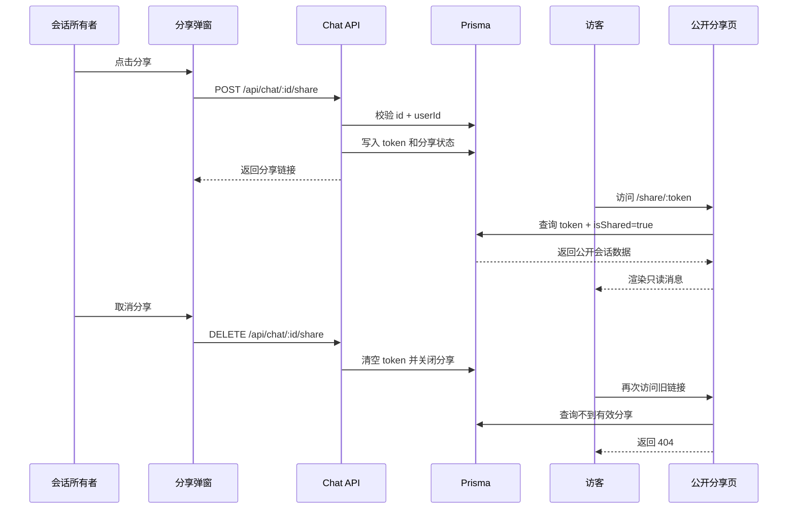

# AI 对话分享功能实现方案

> 状态：待实施
>
> 目标：允许会话所有者生成公开链接，使未登录用户可以只读查看 AI 对话；所有者可以随时取消分享，并让旧链接立即失效。

## 一、方案概述

第一版采用“会话级实时分享”方案：

- 分享时为 `Chat` 生成不可预测且唯一的 `shareToken`。
- 访客通过 `/share/[token]` 查看公开会话，不需要登录。
- 分享期间新增的消息会同步出现在公开页面。
- 取消分享时清空 token，旧链接永久失效。
- 再次分享时生成新的 token，不恢复旧链接。

该方案参考 [Sky-Chat](https://github.com/cquptJerry0/Sky-Chat) 的会话分享结构，并根据本项目现有的 Prisma、Hono API 和 React Query 结构进行调整。

## 二、Prisma 数据结构

在 `prisma/schema.prisma` 的 `Chat` 模型中增加分享字段：

```prisma
model Chat {
  id        String    @id @default(cuid())
  title     String
  userId    String
  createdAt DateTime  @default(now())
  updatedAt DateTime  @updatedAt
  messages  Message[]

  /** 当前会话是否允许通过公开链接访问 */
  isShared Boolean @default(false)

  /** 公开访问令牌，为空表示没有有效的分享链接 */
  shareToken String? @unique

  /** 最近一次开启分享的时间 */
  sharedAt DateTime?

  /** 分享页面的累计访问次数，可在第二阶段启用 */
  viewCount Int @default(0)

  /** 分享页面最近一次被访问的时间，可在第二阶段启用 */
  lastViewedAt DateTime?
}
```

第一版可以只增加 `isShared`、`shareToken` 和 `sharedAt`。分享属于整个会话，因此不需要在 `Message` 模型中重复增加分享字段。

计划使用的迁移命令：

```bash
npm exec prisma migrate dev -- --name add_chat_sharing
npm exec prisma generate
```

## 三、分享状态约定

开启分享时：

```ts
{
  isShared: true,
  shareToken: crypto.randomUUID(),
  sharedAt: new Date(),
}
```

取消分享时：

```ts
{
  isShared: false,
  shareToken: null,
  sharedAt: null,
}
```

取消分享时清空 token，可以防止用户以后重新开启分享时意外恢复旧链接。

## 四、服务端模块

新增 `lib/chat/share.ts`，集中实现分享业务逻辑：

```ts
createChatShare(chatId: string, userId: string)

revokeChatShare(chatId: string, userId: string)

getChatShareStatus(chatId: string, userId: string)

getSharedChat(shareToken: string)
```

职责划分：

- `createChatShare`：校验会话所有权，创建或返回已有分享链接。
- `revokeChatShare`：校验会话所有权，关闭分享并清空 token。
- `getChatShareStatus`：供分享弹窗读取当前状态。
- `getSharedChat`：根据公开 token 查询可展示的会话和消息。

公开会话必须同时满足：

```ts
where: {
  shareToken,
  isShared: true,
}
```

消息按照创建时间升序读取：

```ts
messages: {
  orderBy: {
    createdAt: "asc",
  },
}
```

## 五、参数校验

在 `lib/chat/schemas.ts` 中增加分享参数校验：

```ts
export const shareTokenSchema = z.string().min(20).max(64);
```

如果最终使用 UUID，可以进一步限制 UUID 格式；如果改用 `nanoid`，则按实际 token 长度限制。

## 六、所有者接口

在现有 Chat API 中增加以下接口。

### 1. 查询分享状态

```http
GET /api/chat/:id/share
```

要求：

- 用户必须登录。
- 只能查询自己的会话。
- 用于打开分享弹窗时初始化状态。

响应示例：

```json
{
  "success": true,
  "isShared": true,
  "shareUrl": "/share/xxxxxxxx",
  "sharedAt": "2026-09-23T08:00:00.000Z"
}
```

### 2. 开启分享

```http
POST /api/chat/:id/share
```

处理流程：

1. 根据 `id + userId` 查询会话并校验所有权。
2. 如果会话已经分享，返回现有链接。
3. 如果尚未分享，生成唯一 token。
4. 更新 `isShared`、`shareToken` 和 `sharedAt`。
5. 返回分享地址。

接口保持幂等，重复点击不会创建多个 token。

### 3. 取消分享

```http
DELETE /api/chat/:id/share
```

处理流程：

1. 根据 `id + userId` 校验所有权。
2. 将 `isShared` 设置为 `false`。
3. 清空 `shareToken` 和 `sharedAt`。
4. 返回未分享状态。

即使会话当前没有分享，也可以直接返回成功，减少前端分支。

## 七、公开会话页面

增加公开页面：

```text
app/
  share/
    [token]/
      page.tsx
      loading.tsx
      not-found.tsx
```

页面地址：

```text
/share/:token
```

实现要求：

- 页面放在 Dashboard 路由组之外，不要求登录。
- 使用 Server Component 读取公开会话。
- token 不存在或分享已取消时调用 `notFound()`。
- 页面只提供只读展示，不包含输入框、模型选择和消息操作。
- 使用动态读取或禁用缓存，保证取消分享立即生效。

```ts
export const dynamic = "force-dynamic";
```

页面可以实现 `generateMetadata`，生成会话标题和分享描述。默认不允许搜索引擎收录：

```ts
robots: {
  index: false,
  follow: false,
}
```

## 八、公开数据结构与内容过滤

不要把完整 Prisma 对象返回给公开页面，单独定义公开 DTO：

```ts
interface SharedChatDTO {
  title: string;
  sharedAt: string;
  messages: Array<{
    id: string;
    role: "user" | "assistant";
    parts: PublicMessagePart[];
    createdAt: string;
  }>;
}
```

第一版允许公开：

- 会话标题。
- 分享时间。
- 用户和 AI 消息。
- Markdown 文本。
- 经确认可以公开的附件。

需要过滤：

- `system` 消息。
- `userId`、邮箱等身份信息。
- token 使用量和模型供应商内部 metadata。
- 模型推理内容 `reasoning`。
- 可能包含敏感数据的工具参数和工具结果。

消息展示可以复用现有消息组件，但公开页面不传入编辑、重新生成、工具审批等交互能力。

## 九、前端 Hook

新增 `hooks/use-chat-share.ts`：

```ts
export function useChatShare(chatId?: string) {
  const queryClient = useQueryClient();

  const shareStatus = useQuery({
    queryKey: ["chat-share", chatId],
    queryFn: () => getChatShareStatus(chatId!),
    enabled: Boolean(chatId),
  });

  const createShare = useMutation({
    mutationFn: () => createChatShare(chatId!),
    onSuccess: () => {
      queryClient.invalidateQueries({
        queryKey: ["chat-share", chatId],
      });
    },
  });

  const revokeShare = useMutation({
    mutationFn: () => revokeChatShare(chatId!),
    onSuccess: () => {
      queryClient.invalidateQueries({
        queryKey: ["chat-share", chatId],
      });
    },
  });

  return {
    shareStatus,
    createShare,
    revokeShare,
  };
}
```

如果会话列表需要显示分享状态，可以同时刷新 `chats` 和当前 `chat` 查询缓存。

## 十、分享交互组件

新增：

```text
components/chat/
  chat-share-button.tsx
  chat-share-dialog.tsx
```

分享按钮放在会话顶部区域。新会话在第一条消息保存完成前没有 `chatId`，此时隐藏或禁用分享按钮。

未分享状态：

```text
分享对话

拥有链接的任何人都可以查看这段对话。

[创建公开链接]
```

已分享状态：

```text
分享对话

https://your-domain.com/share/xxxxxxxx

[复制链接] [在新窗口打开]

[取消分享]
```

取消分享前提示：

```text
取消后，之前复制的链接将无法继续访问。
```

## 十一、公开页面 UI

```text
┌──────────────────────────────────────┐
│ Logo                    AI 对话分享  │
├──────────────────────────────────────┤
│ 会话标题                             │
│ 分享于 2026-09-23                    │
│                                      │
│ 用户消息                             │
│ AI Markdown 消息                     │
│ 用户消息                             │
│ AI Markdown 消息                     │
├──────────────────────────────────────┤
│            开始自己的对话            │
└──────────────────────────────────────┘
```

公开页面不显示：

- 输入框。
- 模型切换器。
- 删除、编辑和重新生成按钮。
- 工具审批按钮。
- 私有会话侧边栏。

## 十二、完整数据流程



## 十三、实现顺序

1. 修改 Prisma `Chat` 模型并创建迁移。
2. 编写分享服务和参数校验。
3. 增加查询状态、开启分享和取消分享接口。
4. 完成 `/share/[token]` 公开页面。
5. 抽离可以复用的只读消息渲染组件。
6. 封装 `useChatShare`。
7. 完成分享按钮和弹窗。
8. 过滤公开消息字段和敏感消息 part。
9. 验证未登录访问、取消分享和重新分享流程。

## 十四、验收标准

- 登录用户可以分享自己的会话。
- 未登录用户通过分享链接可以查看会话。
- 其他用户不能修改或取消这个分享。
- 取消分享后，旧链接立即返回 404。
- 再次分享会生成不同的新链接。
- 公开结果不包含 `system` 消息和内部 metadata。
- 未分享的会话无法通过 Chat ID 或 token 在公开页面访问。
- 重复调用开启分享接口不会重复创建 token。

## 十五、后续扩展

第一版不创建单独的 `ChatShare` 表。如果以后需要以下能力，再拆分独立分享模型：

- 固定消息快照。
- 分享链接过期时间。
- 访问密码。
- 同一个会话创建多个链接。
- 独立的链接访问统计。
- 分享版本和历史记录。

