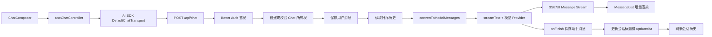

# Wave AI 对话模块开发大纲

## 目标与源码基线

- 项目用途：在现有 Next.js 仪表盘内完成一个支持登录用户、模型切换、流式回复、会话历史和消息持久化的 AI 对话模块。
- 本次目标：先做出可稳定使用的文本对话 MVP，再扩展工具调用、附件、搜索和断线续传。
- 源码基线：Git `ef9c30d`，并包含当前工作区尚未提交的聊天、笔记、布局和依赖改动。
- 已覆盖范围：Prisma 数据模型、Hono API、AI SDK 5 流式调用、客户端 hooks、组件边界、页面路由、UI 状态和验收顺序。
- 暂不覆盖：RAG、向量数据库、语音、多模态文件解析、计费系统、跨设备流恢复。这些应在文本对话闭环稳定后增加。

## 当前状态与必须先处理的问题

当前项目已经具备 Better Auth、Prisma、Hono RPC、TanStack Query、Zustand、AI SDK 5、模型注册和基础布局。聊天模块目前处于“后端半成品、前端占位页”状态：

1. `app/(routes)/(dashboard)/chat/page.tsx` 只显示 `Chat content`。
2. `app/api/[[...route]]/chat.ts` 已能识别用户、创建 Chat、读取 Message，但还没有保存用户消息、调用 `streamText`、返回流、保存助手消息。
3. 历史消息使用 `createdAt: "desc"` 读取后直接追加新消息，顺序会倒置，应改成 `asc`。
4. Chat 查询只按 `id`，没有同时限制 `userId`，存在越权读取或写入其他用户会话的风险。
5. `z.custom<UIMessage>()` 和类型断言只影响 TypeScript，不做运行时校验；模型 ID 也需要白名单校验。
6. Prisma schema 使用 `Message.parts`，已有迁移却创建了 `messages.part`。必须新增迁移对齐字段，不能假设数据库已经与 schema 一致。
7. `lib/ai/provider.ts` 会无条件用 DeepSeek provider 覆盖 `DEVELOPMENT_CHAT_MODEL`，需要确认这是否符合生产环境预期。
8. 首条消息先同步生成标题会延迟首个 token。MVP 可先使用消息截断标题，再在回复结束后异步更新 AI 标题。

## 目标架构



## 推荐目录结构

```text
app/
  (routes)/(dashboard)/chat/
    page.tsx                    # 新会话入口，生成 id 后跳转
    [id]/page.tsx               # 会话页面，加载初始消息
  api/[[...route]]/
    chat.ts                     # 聊天流、列表、详情、改名、删除
components/chat/
  chat-shell.tsx                # 对话页布局和状态编排
  chat-header.tsx               # 标题、模型选择、历史入口
  chat-empty.tsx                # 空会话欢迎区和建议问题
  message-list.tsx              # 消息列表、自动滚动
  message-item.tsx              # 用户/助手消息容器
  message-parts.tsx             # text/reasoning/source/tool/file 分片渲染
  chat-composer.tsx             # 输入框、发送、停止、重试
  model-selector.tsx            # 模型选择
  tool-selector.tsx             # 工具选择，第二阶段启用
  chat-history.tsx              # 历史列表或 Sheet
  chat-history-item.tsx         # 打开、改名、删除
  chat-error.tsx                # 可恢复错误提示
hooks/
  use-ai-chat.ts                # 封装 useChat 和 transport
  use-chat-history.ts           # 会话列表查询和改名/删除 mutation
  use-chat-scroll.ts            # 自动滚动与“回到底部”
  use-chat-preferences.ts       # 模型和工具偏好，可持久化
lib/chat/
  schemas.ts                    # 请求和消息 metadata 的 Zod schema
  queries.ts                    # 服务端所有权查询、消息查询
  persistence.ts                # 幂等保存用户/助手消息
  mapper.ts                     # Prisma Message 与 UIMessage 互转
lib/ai/
  model.ts                      # 模型目录与运行时白名单
  provider.ts                   # 模型实例注册
  prompts.ts                    # 系统提示词与标题提示词
```

## Prisma 数据设计

MVP 推荐保留 AI SDK 的 `parts` JSON 作为消息正文，因为它能统一存储文本、推理、来源、文件和工具调用。检索、计费等明确需要查询的字段再单独成列。

```prisma
model Chat {
  id            String    @id @default(uuid())
  title         String    @default("新对话")
  modelId       String?
  createdAt     DateTime  @default(now())
  updatedAt     DateTime  @updatedAt
  userId        String
  user          User      @relation(fields: [userId], references: [id], onDelete: Cascade)
  messages      Message[]

  @@index([userId, updatedAt(sort: Desc)])
  @@map("chats")
}

model Message {
  id               String   @id
  role             Role
  parts            Json
  metadata         Json?
  modelId          String?
  finishReason     String?
  promptTokens     Int?
  completionTokens Int?
  createdAt        DateTime @default(now())
  updatedAt        DateTime @updatedAt
  chatId           String
  chat             Chat     @relation(fields: [chatId], references: [id], onDelete: Cascade)

  @@index([chatId, createdAt])
  @@map("messages")
}
```

实施规则：

- 新增迁移把数据库中的 `part` 改为 `parts`，然后重新生成 Prisma Client。
- Chat 列表只返回当前用户的数据，按 `updatedAt desc` 分页。
- Message 按 `createdAt asc` 返回。
- 客户端生成的用户消息 ID 直接作为主键，用 `upsert` 或“存在则跳过”实现重试幂等。
- 助手消息 ID 由服务端 `generateMessageId` 生成，并在 `onFinish` 中保存。
- 所有 Chat 的读、写、删除必须同时校验 `id` 和 `userId`。
- 令牌用量属于第二优先级；当前 provider 无法稳定返回时保留空值，不伪造数据。

## API 合约

| 方法 | 路径 | 作用 | 核心返回 |
| --- | --- | --- | --- |
| `POST` | `/api/chat` | 提交消息并返回 UI message stream | SSE 流 |
| `GET` | `/api/chat` | 分页读取当前用户会话 | `items + nextCursor` |
| `GET` | `/api/chat/:id` | 读取会话和升序消息 | `chat + messages` |
| `PATCH` | `/api/chat/:id` | 修改标题或归档状态 | 更新后的 chat |
| `DELETE` | `/api/chat/:id` | 删除当前用户会话 | `{ success: true }` |

`POST /api/chat` 建议请求体：

```ts
{
  id: string;
  message: UIMessage;
  selectedModelId: ChatModelId;
  selectedToolName: ToolName | null;
  trigger: "submit-message" | "regenerate-message";
}
```

服务端处理顺序固定为：

1. Zod 校验基本结构，再使用 AI SDK 的消息校验能力检查 parts。
2. 从会话读取用户身份，不接受客户端传入 `userId`。
3. 查询 `Chat` 所有权；不存在则为当前用户创建，存在但不属于当前用户则统一返回 404。
4. 校验 `selectedModelId` 是否在服务端模型白名单内。
5. 幂等保存本轮用户消息。
6. 按时间升序读取完整历史，并映射为 `UIMessage[]`。
7. `convertToModelMessages(messages)` 后调用 `streamText`。
8. 用 `toUIMessageStreamResponse({ originalMessages, generateMessageId, onFinish })` 返回流。
9. `onFinish` 保存 `responseMessage`，更新 Chat 时间与标题。
10. `onError` 只返回用户可理解的信息，服务端记录原始错误；不得把密钥或 provider 原始响应暴露给浏览器。

## Hook 设计

### `useAiChat`

唯一负责实时对话状态，不再用 Zustand 复制一份 messages。

- 输入：`chatId`、`initialMessages`、`selectedModelId`、`selectedToolName`。
- 内部：`useChat({ id, messages, transport: new DefaultChatTransport(...) })`。
- transport 的 `prepareSendMessagesRequest` 只发送最后一条用户消息和当前选择项。
- 输出：`messages`、`status`、`error`、`sendText`、`regenerate`、`stop`、`clearError`。
- `sendText` 负责 trim、空值拦截和调用 `sendMessage({ text })`。
- `onFinish` 只负责刷新 React Query 的会话列表；消息落库以服务端 `onFinish` 为准。

### `useChatHistory`

- `useInfiniteQuery` 加载会话列表，query key 为 `['chats']`。
- `useRenameChat` 成功后同时更新列表缓存和详情缓存。
- `useDeleteChat` 先做乐观移除，失败回滚；若删除的是当前会话则跳到 `/chat`。

### `useChatPreferences`

- Zustand `persist` 只保存 `selectedModelId`、`selectedToolName` 和 UI 偏好。
- 从持久化状态恢复时再次与服务端模型列表对照，过期模型回退到默认值。

### `useChatScroll`

- 用户位于底部附近时，流式 token 到达后自动滚动。
- 用户主动向上阅读时停止抢滚动，并显示“回到底部”按钮。
- 新发送消息后强制滚到底部一次。

## 组件与 UI 设计

### 页面布局

- 页面使用 `h-dvh`/可用高度的纵向 flex，避免整个浏览器跟着消息列表滚动。
- 顶部 `ChatHeader` 固定，显示会话标题、模型选择和历史入口。
- 中间 `MessageList` 独立滚动，内容最大宽度建议 `max-w-3xl`。
- 底部 `ChatComposer` 粘在内容区底部，并保留移动端安全区。

### 空状态

- 显示产品名、一句引导语和 3–4 个建议问题。
- 点击建议问题只填入或直接发送，行为保持一致并明确。
- 没有消息时不渲染空白的 MessageList。

### 消息渲染

- 用户消息靠右并使用轻量强调背景；助手消息占更宽内容区。
- `MessageParts` 按 `part.type` 分派：`text`、`reasoning`、`source-url`、`source-document`、`file`、`tool-*`。
- MVP 先支持 text；未知 part 显示安全占位，避免整条消息崩溃。
- Markdown、代码高亮和表格可作为第二阶段依赖；在未安装渲染库前使用 `whitespace-pre-wrap`。
- 助手消息完成后显示复制、重新生成按钮；流式中显示轻量状态，不使用持续闪烁的大面积骨架屏。

### 输入区

- 使用已有 `AutosizeTextarea`，Enter 发送，Shift+Enter 换行。
- `submitted` 状态禁用重复提交；`streaming` 状态把发送按钮切换为停止按钮。
- 支持粘贴长文本，设置合理最大高度后内部滚动。
- 模型选择器靠近输入框；工具选择器先隐藏或标为实验功能，直到后端真实实现。
- 错误提示放在输入框上方，可重试并保留原输入。

### 历史记录

- 桌面端可放在侧栏分组，移动端使用 Sheet。
- 每项显示标题和更新时间，当前会话有选中态。
- 菜单提供改名和删除；删除必须有确认对话框。
- 列表使用 cursor 分页，避免消息增长后一次性加载所有会话。

### 可访问性与响应式

- 消息流容器使用 `aria-live="polite"`，按钮提供可读 label。
- 键盘可完成发送、停止、选择模型、打开历史和关闭弹层。
- 移动端不依赖 hover；触控目标至少保持按钮默认尺寸。
- 深浅色继续使用现有 CSS token，不在聊天组件内写死颜色。

## 课程 01：先修正数据与安全边界

读完能回答：一条消息在数据库中怎样被可靠归属到当前用户？

主链：迁移触发 → `schema.prisma` → 修正字段与索引 → `prisma migrate dev` → Prisma Client 与数据库一致。

必读顺序：

1. `prisma/schema.prisma` 的 `Chat`、`Message`：输入是业务持久化要求，输出是模型和索引定义。
2. `prisma/migrations/20260525133128_init/migration.sql` 的 `messages`：输入是既有数据库结构，输出是 `part`/`parts` 差异证据。
3. `lib/prisma.ts` 的 Prisma 实例：输入是 schema 生成客户端，输出是 API 可复用的数据访问对象。
4. `lib/hono/hono-middware.ts` 的 `getAuthUser`：输入是请求 cookie/header，输出是可信 `user` 上下文。

选读证据：`lib/auth.ts`。暂缓阅读：笔记 CRUD，它只用于参考 hook/API 风格。状态：`大纲`。

## 课程 02：建立模型选择与服务端校验

读完能回答：用户选择模型后，服务端怎样保证只能调用已允许的模型？

主链：选择模型 → 请求体 modelId → Zod 白名单 → provider registry → language model 实例。

必读顺序：

1. `lib/ai/model.ts` 的 `chatModels`、`DEFAULT_MODEL_ID`：输入是可用模型配置，输出是 UI 选项与白名单。
2. `lib/ai/provider.ts` 的 `createLanguageModels`、`myProvider`：输入是模型 ID，输出是 provider 对应实例。
3. `app/api/[[...route]]/chat.ts` 的 `chatSchema`：输入是浏览器请求，输出是可信参数。

选读证据：`.env` 的 key 名称，只检查是否配置，不读取或传播值。暂缓阅读：工具选择，因为当前没有工具实现。状态：`大纲`。

## 课程 03：打通一次完整流式对话

读完能回答：从点击发送到助手逐字显示，中间发生了什么？

主链：提交文本 → `useAiChat.sendText` → `DefaultChatTransport` → Hono POST → `streamText` → UI message stream → `MessageList`。

必读顺序：

1. `hooks/use-ai-chat.ts` 的 `useAiChat`：输入是文本和偏好，输出是客户端消息状态与流控制。
2. `app/api/[[...route]]/route.ts` 的 `/chat` 挂载：输入是 `/api/chat` 请求，输出是 chatRoute。
3. `app/api/[[...route]]/chat.ts` 的 POST handler：输入是用户消息，输出是 SSE response。
4. `lib/ai/provider.ts` 的 `myProvider.languageModel`：输入是已校验 modelId，输出是语言模型。
5. `components/chat/message-parts.tsx`：输入是不断更新的 parts，输出是可见内容。

选读证据：`node_modules/ai/dist/index.d.ts` 中 `streamText`、`toUIMessageStreamResponse`、`convertToModelMessages`。暂缓阅读：历史列表。状态：`大纲`。

## 课程 04：保证消息持久化和重试幂等

读完能回答：网络重试为什么不会重复插入同一条用户消息？

主链：收到消息 → 校验所有权 → 幂等保存 user message → 启动流 → `onFinish` 保存 assistant message → 更新时间。

必读顺序：

1. `lib/chat/persistence.ts` 的保存函数：输入是 UIMessage，输出是唯一数据库记录。
2. `lib/chat/mapper.ts` 的双向映射：输入是 Prisma JSON/AI SDK parts，输出是稳定的 UIMessage。
3. `app/api/[[...route]]/chat.ts` 的流完成回调：输入是 responseMessage，输出是助手消息和会话更新时间。

选读证据：Prisma 唯一键冲突行为。暂缓阅读：跨进程流恢复；MVP 断开后允许重新生成。状态：`大纲`。

## 课程 05：完成聊天页面与核心组件

读完能回答：哪些状态应该由 AI SDK 管，哪些状态应该由组件本地管理？

主链：路由 chatId → 初始消息 → `ChatShell` → `MessageList` + `ChatComposer` → 用户交互。

必读顺序：

1. `app/(routes)/(dashboard)/chat/[id]/page.tsx`：输入是路由 ID，输出是带初始数据的页面。
2. `components/chat/chat-shell.tsx`：输入是 chat 与 messages，输出是整体对话状态编排。
3. `components/chat/message-list.tsx`、`message-item.tsx`、`message-parts.tsx`：输入是 messages，输出是可访问的消息 UI。
4. `components/chat/chat-composer.tsx`：输入是 status 和草稿，输出是 send/stop 事件。
5. `hooks/use-chat-scroll.ts`：输入是消息变化和滚动位置，输出是滚动策略。

选读证据：`components/ui/autosize-textarea.tsx`、现有 Button/Select/Sheet。暂缓阅读：高级 Markdown 样式。状态：`大纲`。

## 课程 06：实现会话历史管理

读完能回答：新建、打开、改名和删除会话怎样保持 UI 与数据库一致？

主链：历史面板打开 → Query 拉取列表 → 选择路由 → mutation 改名/删除 → 缓存同步。

必读顺序：

1. `app/api/[[...route]]/chat.ts` 的 GET/PATCH/DELETE：输入是分页或会话 ID，输出是用户范围内的数据。
2. `hooks/use-chat-history.ts`：输入是 API 合约，输出是 query/mutation 状态。
3. `components/chat/chat-history.tsx`：输入是分页列表，输出是历史导航。
4. `app/(routes)/(dashboard)/_common/header.tsx`：输入是打开历史/新建事件，输出是导航动作。

选读证据：`hooks/use-note.ts` 的现有 React Query 写法。暂缓阅读：搜索会话全文。状态：`大纲`。

## 课程 07：补齐异常状态与交互质量

读完能回答：模型报错、断网、用户停止和空回复时页面分别怎样恢复？

主链：异常发生 → 服务端安全错误映射或客户端 status → 保留上下文 → 重试/停止/清错 → 恢复 ready。

必读顺序：

1. `app/api/[[...route]]/route.ts` 的 `onError`：输入是服务器异常，输出是标准 HTTP 错误。
2. `app/api/[[...route]]/chat.ts` 的 stream `onError/onFinish`：输入是 provider 或中止事件，输出是安全消息与持久化状态。
3. `hooks/use-ai-chat.ts` 的 `status/error/stop/regenerate`：输入是流生命周期，输出是页面动作。
4. `components/chat/chat-error.tsx`、`chat-composer.tsx`：输入是错误和状态，输出是用户可恢复路径。

选读证据：Sonner 的现有使用方式。暂缓阅读：自动多次重试，避免重复计费。状态：`大纲`。

## 课程 08：验证与分阶段交付

读完能回答：怎样证明聊天模块已达到可用状态？

主链：迁移检查 → 类型与 lint → 构建 → 双用户安全测试 → 流式与历史手测 → 交付。

必读顺序：

1. `package.json` 的 `db:migrate`、`typecheck`、`lint`、`build`：输入是实现结果，输出是静态和构建证据。
2. `/chat/[id]` 真实页面：输入是发送、停止、刷新、重试、删除动作，输出是用户可见结果。
3. 数据库 Chat/Message 记录：输入是两名用户的操作，输出是隔离、顺序和幂等证据。

验收清单：

- 新会话首条消息能尽快开始流式显示。
- 刷新页面后消息顺序和内容一致。
- 同一个请求重试不会产生重复用户消息。
- 用户 A 无法读取、修改或删除用户 B 的 chat id。
- 模型 ID 非法时在调用 provider 前返回 400。
- 停止生成后 UI 回到可操作状态，已生成内容的保存策略明确。
- 删除当前会话后跳转到新会话页，历史缓存同步。
- 空输入不会发送；Enter/Shift+Enter、移动端输入和自动滚动符合预期。
- `npm run typecheck`、`npm run lint`、`npm run build` 通过。

选读证据：浏览器 Network 中的 SSE 数据帧和服务端日志。暂缓阅读：压测与成本报表。状态：`大纲`。

## 推荐实施顺序

1. 修复 Prisma `part/parts` 差异，增加所有权和排序索引。
2. 抽出 model allowlist、chat schemas、mapper、persistence。
3. 完成 `POST /api/chat` 的保存、`streamText`、流返回和结束落库。
4. 创建 `/chat/[id]` 与 `useAiChat`，先打通纯文本流。
5. 完成 MessageList、MessageParts、Composer、空状态和错误状态。
6. 增加会话列表、详情、改名、删除接口及 React Query hooks。
7. 加入模型选择持久化、停止、重新生成、复制和滚动控制。
8. 做双用户越权、刷新恢复、请求重试和响应式验收。
9. 文本闭环稳定后，再加入 Markdown、工具调用、附件、来源卡片和 RAG。

## 自学提醒

若某个文件或原理看不懂，可以继续追问 AI 展开对应课程；本大纲负责给出学习与实现路线，没有逐行讲解全部源码。

