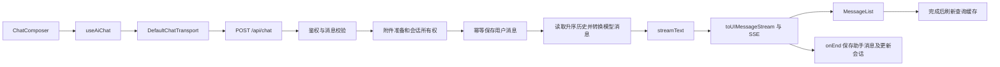

# Wave AI 对话模块开发大纲

> 更新日期：2026-10-12。源码基线：Git 0d2e921 及当前工作区。
> 本文区分已实现功能与待验收内容；以本地源码和 package.json 为准，遵循 AGENTS.md。

## 目标与当前状态

Wave AI 已具备登录用户的聊天页面、模型选择、流式回复、会话历史、消息持久化和 OSS 附件处理。当前使用 AI SDK 7，聊天已经进入功能验收与维护阶段。

项目下一批开发重点是知识库 P2：上传、文件树、解析状态和 Markdown 阅读，再补编辑保存。详细计划见 [知识库大纲](KNOWLEDGE_FILE_MARKDOWN_OUTLINE.md)。

| 能力 | 实现状态 | 源码位置 |
| --- | --- | --- |
| 登录态与所有权 | 已有中间件及用户范围查询 | lib/hono/hono-middware.ts、lib/chat/persistence.ts |
| 流式对话与落库 | 已有用户消息保存、模型流和助手消息保存 | app/api/[[...route]]/chat.ts |
| 聊天页面 | 已有 ChatShell、输入区和消息列表 | app/(routes)/(dashboard)/chat/page.tsx、components/chat/ |
| 会话管理 | 列表、详情、改名、置顶和删除已实现 | hooks/use-chat-list.ts、components/sidebar/nav-chats.tsx |
| 模型选择 | 白名单、图片模型选择和生成预算已配置 | lib/ai/model.ts、provider.ts、generation-settings.ts |
| Markdown 与推理展示 | 已有 Streamdown、按需插件和折叠推理区 | components/chat/message-list.tsx、components/ai-elements/ |
| 附件 | 已有上传、预览、站内读取及模型输入准备 | lib/chat-attachment-storage.ts、lib/chat-attachment-preparer.ts |
| 工具与 RAG | 尚未实现；非空 selectedToolName 会被拒绝 | chat.ts、知识库后续阶段 |

上述状态说明代码存在，不代表真实模型请求、双用户隔离和所有浏览器交互已经验收。

## 现有架构与处理流程



- 页面使用 /chat；已有会话通过 /chat?chatId=UUID 打开，没有独立 /chat/[id] 路由。
- 新会话由页面生成 UUID，首次发送时创建数据库记录。
- 会话初始标题来自首条消息的截断文本，没有已实现的异步 AI 标题流程。
- 模型历史由服务端读取，客户端发送本轮用户消息和选择项。
- 重新生成时，服务端删除目标用户消息之后的旧分支，并清理相关附件。
- 外部 Chat 实例使同一页面会话中的路由切换可以继续订阅生成；这不是跨设备或整页刷新后的流恢复。

## 当前目录与模块职责

```text
app/(routes)/(dashboard)/chat/page.tsx
app/api/[[...route]]/chat.ts
app/api/[[...route]]/route.ts

components/chat/
  chat-shell.tsx                 # 历史加载、模型、草稿和界面编排
  chat-composer.tsx              # 输入、模型、附件、发送与停止
  message-list.tsx               # 文本、推理、附件、消息操作和虚拟列表
  attachment-preview.tsx
  model-brand-icon.tsx
components/sidebar/
  nav-chats.tsx
  chat-sidebar-item.tsx
components/ai-elements/
  message.tsx                   # Streamdown 渲染
  use-streamdown-plugins.ts      # 代码、公式、Mermaid 按需加载
  conversation.tsx              # 滚动与回到底部

hooks/
  use-ai-chat.ts
  use-chat-list.ts
stores/chat-ui-store.ts          # 草稿、模型、滚动位置与 sessionStorage
lib/chat/
  schemas.ts
  persistence.ts
  mapper.ts
  model-attachments.ts
  attachment-preview.ts
  normalize-markdown-math.ts
lib/chat-attachment-storage.ts
lib/chat-attachment-preparer.ts
lib/storage/oss.ts
lib/ai/
  model.ts
  provider.ts
  generation-settings.ts
  prompts.ts
```

不为符合旧架构图额外拆出 message-parts、chat-history、chat-error 或多个滚动/偏好 Hook。沿用当前职责划分。

## 数据模型与安全约束

以 prisma/schema.prisma 为准：

- Chat 保存 userId、title、modelId、isPinned、pinnedAt 及时间字段。
- Message 使用 parts JSON，保存 metadata、模型、完成原因和可用的 Token 用量。
- 消息按 createdAt 升序读取，消息 ID 用于幂等插入及冲突检查。
- ChatAttachment 保存用户、OSS 对象键、文件类型、大小、哈希和可选提取文本；发送成功后关联消息。
- 查询、修改、删除已有会话均限制当前用户范围。
- PDF/DOCX 聊天附件的文字提取与知识库 MinerU 解析是两条不同流程。

20260923172552_align_chat_message_schema 已提供 part/parts 对齐和相关字段迁移，20260923122414_add_chat_pinning 已提供置顶迁移，20261010123000_add_chat_attachments 已提供附件迁移。上线或新环境仍需核实迁移实际执行情况。

令牌用量缺失时保持空值，中止时允许保存已生成的部分回答。所有权和消息冲突错误保留明确的 HTTP 状态。

## 已有 API 合约

| 方法 | 路径 | 作用 |
| --- | --- | --- |
| POST | /api/chat | 发送消息，返回 UIMessage SSE |
| GET | /api/chat | 游标分页列表，返回 items 和 nextCursor |
| GET | /api/chat/:id | 会话信息与升序消息 |
| PATCH | /api/chat/:id | 修改 title 或 isPinned |
| DELETE | /api/chat/:id | 删除会话及消息，清理附件 |
| POST | /api/chat/attachments | 上传附件到私有 OSS |
| GET | /api/chat/attachments/:id | 鉴权读取附件 |
| DELETE | /api/chat/attachments/:id | 删除尚未认领的临时附件 |
| POST | /api/chat/attachments/preview | 提取 PDF/DOCX 文字，不持久化文件 |

POST /api/chat 的核心请求字段：

```ts
{
  id: string
  message: UIMessage
  selectedModelId: ChatModelId
  selectedToolName: string | null
  trigger: "submit-message" | "regenerate-message"
}
```

当前 selectedToolName 必须为 null。请求先经 Zod 校验，再由 AI SDK 校验 UIMessage 的语义。模型必须属于项目白名单，图片消息按配置选择视觉模型。

实际流 API 为 streamText -> toUIMessageStream -> createUIMessageStreamResponse。助手消息在服务端 onEnd 中保存；客户端 onFinish 负责刷新查询和清理实例缓存，两者不是同一个回调。

## Hook、状态与界面

### useAiChat

- 通过已有 DefaultChatTransport 发送最后一条用户消息和当前模型/工具参数。
- 先上传附件至 OSS，再发送稳定的站内文件地址；失败时尝试回收临时附件。
- Chat/useChat 管理 messages、status、error、发送、停止和重新生成。
- 当前生成实例保存在页面级 Map 中，以支持仪表盘内切换页面继续生成。
- 完成或错误时刷新会话列表和详情；普通空闲实例在卸载后清理。

### 会话查询与 UI 状态

- useChatList 使用 useQuery，默认请求最近 50 条；后端虽支持 cursor，前端尚未接入无限翻页。
- useChatDetail 查询详情；useUpdateChat 与 useDeleteChat 刷新或移除相关缓存。
- useChatUiStore 按 chatId 保存草稿、模型和滚动位置，使用 sessionStorage，退出时清理。
- Zustand 不维护第二份消息正文；远端数据沿用 TanStack Query。

### 消息渲染与交互

- MessageList 处理文本、推理和附件，助手正文使用 Streamdown。
- 已有代码、数学公式、Mermaid 和中文插件能力，部分插件按内容加载。
- 已有复制、重新生成、Markdown 下载及消息列表虚拟化代码。
- Conversation 与列表处理滚动、回到底部和滚动位置恢复。
- ChatComposer 处理附件、模型选择、发送及停止；工具选择尚未启用。
- 空状态建议问题用于填入输入框，当前不是自动发送。

## 课程 01：理解数据与安全边界

状态：实现已具备；本节保留为源码阅读大纲，真实数据库和双用户验收待确认。

主链：迁移 -> Prisma 模型 -> 登录中间件 -> 会话归属 -> 用户范围查询。

阅读顺序：

1. prisma/schema.prisma：Chat、Message、ChatAttachment。
2. prisma/migrations/20260923172552_align_chat_message_schema/migration.sql：字段对齐。
3. lib/hono/hono-middware.ts：getAuthUser。
4. lib/chat/persistence.ts：getOrCreateOwnedChat、ChatOwnershipError。
5. app/api/[[...route]]/chat.ts：GET/PATCH/DELETE 的用户条件。

理解问题：消息 ID、会话 ID 和登录用户之间的归属关系如何保证？

## 课程 02：模型选择与请求校验

状态：实现已具备；实际供应商调用与预算效果待联调。

主链：模型选择 -> sendChatMessageSchema -> resolveChatModelId -> myProvider -> 生成配置。

阅读顺序：

1. lib/ai/model.ts：CHAT_MODEL_IDS、chatModels、resolveChatModelId。
2. lib/chat/schemas.ts：sendChatMessageSchema。
3. lib/ai/provider.ts：myProvider、getChatGenerationSettings。
4. lib/ai/generation-settings.ts：getModelGenerationSettings。
5. components/chat/chat-shell.tsx：图片输入时的模型选择。

理解问题：为什么服务端还需要决定实际执行模型？仅核查环境变量是否配置，不读取或传播密钥值。

## 课程 03：一次完整流式对话

状态：实现已具备；真实流式交互待验收。

主链：输入 -> sendText -> transport -> POST -> streamText -> SSE -> MessageList。

阅读顺序：

1. components/chat/chat-composer.tsx：提交事件。
2. hooks/use-ai-chat.ts：sendText、chatTransport。
3. app/api/[[...route]]/route.ts：chatRoute 挂载。
4. app/api/[[...route]]/chat.ts：POST、streamText、toUIMessageStream。
5. components/chat/message-list.tsx：正文及推理渲染。

理解问题：客户端发送本轮消息后，完整模型历史来自哪里？

## 课程 04：持久化、幂等与重新生成

状态：实现已具备；数据库故障、重试和中止的端到端验收待确认。

主链：保存用户消息 -> 读取历史 -> 处理旧分支 -> 模型生成 -> onEnd 保存助手消息。

阅读顺序：

1. lib/chat/persistence.ts：saveMessageOnce、MessageConflictError。
2. lib/chat/mapper.ts：toUIMessage。
3. app/api/[[...route]]/chat.ts：savedUserMessage、regenerate-message 分支及 onEnd。
4. lib/chat-attachment-storage.ts：附件认领及旧分支清理。

理解问题：重复消息与合法重新生成如何区分？中止时保存什么内容？

## 课程 05：页面、组件与状态归属

状态：聊天页面已实现；可访问性及移动端交互待验收。

主链：/chat?chatId=UUID -> useChatDetail -> ChatShell -> useAiChat -> 输入区和消息列表。

阅读顺序：

1. app/(routes)/(dashboard)/chat/page.tsx：searchParams 和会话 ID。
2. components/chat/chat-shell.tsx：历史初始化、草稿和模型。
3. hooks/use-ai-chat.ts：Chat 实例与 useChat 订阅。
4. components/chat/message-list.tsx、chat-composer.tsx。
5. stores/chat-ui-store.ts：草稿与滚动位置。

理解问题：流、消息、草稿、查询缓存分别由谁管理？

## 课程 06：会话历史管理

状态：基本管理已实现；前端连续分页尚未接入。

主链：列表查询 -> 侧栏选择 -> /chat?chatId=UUID -> 改名/置顶/删除 -> 缓存同步。

阅读顺序：

1. app/api/[[...route]]/chat.ts：列表及 CRUD。
2. hooks/use-chat-list.ts：useChatList、useChatDetail、useUpdateChat、useDeleteChat。
3. components/sidebar/nav-chats.tsx、chat-sidebar-item.tsx。
4. stores/chat-ui-store.ts：removeChat。

理解问题：后端 nextCursor 已返回，为什么当前界面仍只展示一批会话？

## 课程 07：附件与异常恢复

状态：附件和基本恢复逻辑已实现；异常路径待真实联调。

主链：附件上传 -> 校验与 OSS -> 站内 URL -> 模型输入准备 -> 生成/失败 -> 保存或清理。

阅读顺序：

1. hooks/use-ai-chat.ts：uploadAttachment、sendText、stop、regenerate。
2. lib/chat-attachment-storage.ts：uploadChatAttachment、readOwnedChatAttachment。
3. lib/chat-attachment-preparer.ts：createStoredAttachmentPreparer。
4. lib/chat/model-attachments.ts：文本提取与模型输入。
5. app/api/[[...route]]/chat.ts：附件路由、onError、onEnd。

理解问题：聊天附件与知识库文档有哪些不同？模型失败、停止和切页分别如何处理？

## 课程 08：验证与后续交付

状态：知识库已有自动化测试；聊天专用回归测试和真实交互验收仍需补齐。

验收清单：

- [ ] 新建、发送、停止、重新生成及刷新恢复。
- [ ] 改名、置顶、删除和当前会话导航。
- [ ] 双用户越权读取、更新、删除被拒绝。
- [ ] 重复请求不重复插入用户消息，合法重新生成保持正确分支。
- [ ] 文档和图片附件正常，发送失败及删除后的资源处理符合预期。
- [ ] 非法模型/工具在模型调用前失败，图片消息选择符合配置。
- [ ] 仪表盘内切页继续生成与整页刷新后的行为分别验证。
- [ ] 输入、滚动、移动端及键盘操作符合预期。

现有检查命令：npm run typecheck、npm test、npm run lint、npm run build。知识库测试使用模拟服务，不能作为聊天真实模型和浏览器验收的证据。

最近一次全量 lint 存在 Prisma 生成文件及其他组件报错，知识库范围 lint 已通过；修复全量检查问题应单独处理，不修改生成文件来消除报错。

## 下一步实施顺序

1. 按知识库大纲做 P2-a：列表、文件树、上传、状态和只读预览，并联调现有 P1。
2. 做 P2-b：正文保存、乐观锁、阅读/编辑/对照，再补自动保存。
3. 做 P2-c：下载原件、单文档删除和重新解析。
4. 完成 P3：当前正文版本分块，再确定 Embedding 和 RAG 接入。
5. 聊天按实际问题补充回归测试、连续分页和交互验收；工具、语音、计费及跨设备流恢复另行规划。

## 自学提醒

保留以上课程编号用于后续展开。若某个文件或原理看不懂，可以继续追问 AI；本文负责列出实际源码和开发顺序，未展开逐行课程。

